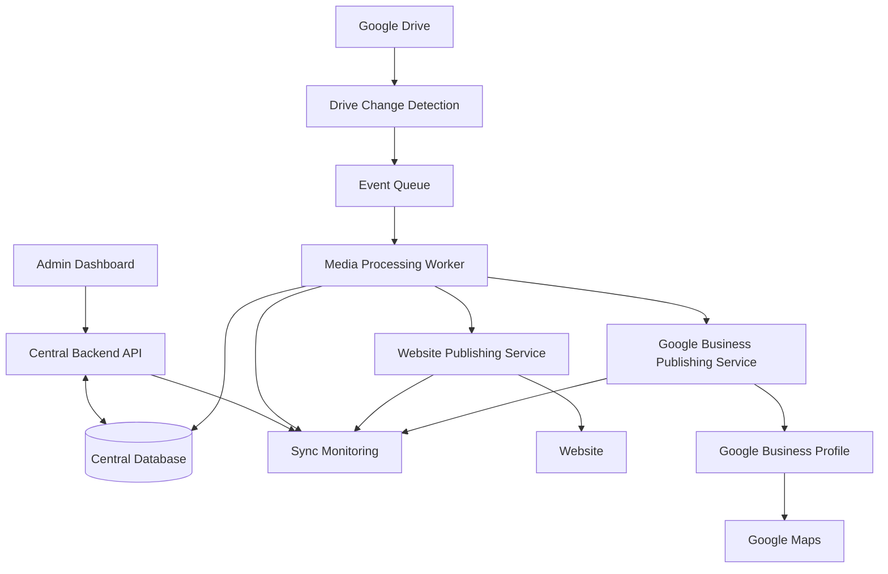
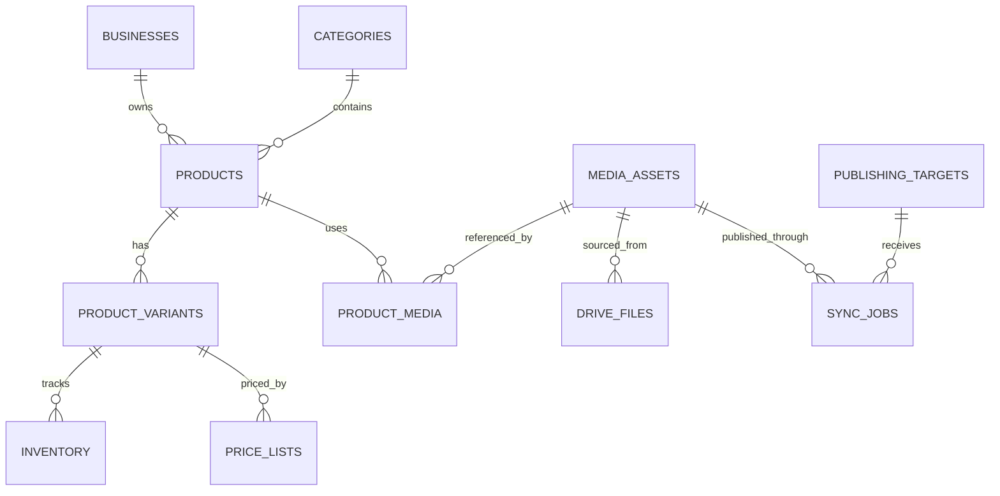
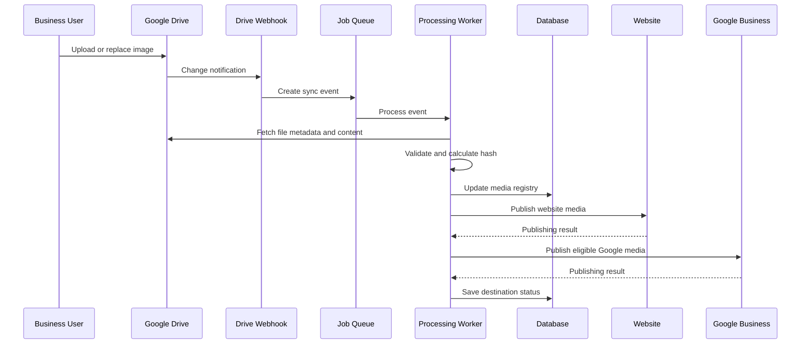
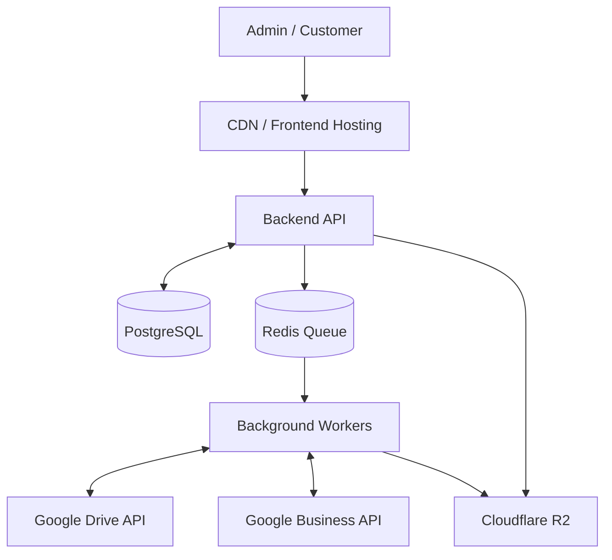

# JAIN SARАFA THELLA
# Central Business Management & Digital Presence Platform
## Complete HLD, LLD, System Architecture & Implementation Blueprint

**Document Version:** 1.0  
**Project:** Jain Sarafa Thella (JST)  
**Business Location:** Agra, Uttar Pradesh, India  
**Architecture Type:** Centralized, API-driven, event-based synchronization platform  
**Document Status:** Architecture & Planning  
**Primary Objective:** Manage the entire business from one central platform and synchronize approved information and media with the website, Google Business Profile and Google Maps.

---

# 1. Executive Summary

Jain Sarafa Thella requires a centralized digital business management platform that provides one place to manage business information, product catalogues, size-wise variants, media assets, inventory, retail and wholesale information, and online presence.

The system will integrate:

1. Central Admin Dashboard.
2. Central Business Database.
3. Google Drive Media Management.
4. Business Product Catalogue.
5. Website and Ecommerce System.
6. Google Business Profile API.
7. Google Maps Business Listing.
8. Background Synchronization Engine.
9. Integration Monitoring and Audit System.

The system must support automatic synchronization wherever the destination platform permits it.

## 1.1 Core architectural principles

| Principle | Implementation |
|---|---|
| Single Source of Truth | Central database |
| Media Management | Google Drive |
| Product Structure | Parent product + size variants |
| API-first | All integrations through backend APIs |
| Event-driven | Background event processing |
| Reliability | Retry, idempotency and reconciliation |
| Security | OAuth, RBAC and encrypted credentials |
| Observability | Logs, alerts and sync dashboard |
| Scalability | Modular architecture |

# 2. Business Domain Understanding

## 2.1 Business model

Jain Sarafa Thella operates across:

- Bag manufacturing.
- Retail sales.
- Wholesale and bulk supply.
- Product customization and size-based offerings.

The platform should support both B2C and B2B customers.

## 2.2 Product catalogue requirements

The most important requirement is that products are available in different sizes.

A product should have:

- Product name.
- Product category.
- Product SKU.
- Description.
- Material.
- Colour.
- Size variants.
- Dimensions.
- Weight, if applicable.
- Retail price.
- Wholesale price.
- Minimum order quantity.
- Stock availability.
- Product images.
- Manufacturing information.

**Important:** A product with three sizes should be one parent product with three separate variants, not three unrelated products.

# 3. Product Catalogue Architecture

## 3.1 Hierarchical product model

```text
Business
   |
   └── Product Category
          |
          └── Parent Product
                 |
                 ├── Product Information
                 |
                 ├── Product Media
                 |
                 └── Size Variants
                        |
                        ├── Small
                        ├── Medium
                        ├── Large
                        └── Custom Size
```

## 3.2 Example product structure

The following is an illustrative example, not a confirmed existing product.

```text
JST
 |
 └── Shopping Bags
       |
       └── Premium Shopping Bag
              |
              ├── SKU: JST-SB-001-S
              |      Size: Small
              |      Dimensions: 8 x 10 inches
              |      Retail Price: ₹100
              |
              ├── SKU: JST-SB-001-M
              |      Size: Medium
              |      Dimensions: 10 x 12 inches
              |      Retail Price: ₹140
              |
              └── SKU: JST-SB-001-L
                     Size: Large
                     Dimensions: 12 x 16 inches
                     Retail Price: ₹180
```

## 3.3 Product and variant separation

| Attribute | Parent product | Variant |
|---|---|---|
| Product name | Yes | Inherited |
| Category | Yes | Inherited |
| Description | Yes | Optional override |
| Material | Yes | Optional override |
| Size | No | Yes |
| Dimensions | Default | Yes |
| SKU | No | Yes |
| Price | Default | Yes |
| Stock | No | Yes |
| Variant images | Shared gallery | Optional |
| MOQ | Default | Yes |

The database must support custom size values rather than restricting the business to Small, Medium and Large.

## 3.4 Product categories

Categories should be configurable from the admin panel.

Illustrative structure:

```text
Products
 |
 ├── Shopping Bags
 ├── Carry Bags
 ├── Packaging Bags
 ├── Jewellery / Sarafa Bags
 ├── Customised Bags
 └── Other Products
```

Only actual business categories should be published.

# 4. Google Drive Architecture

Google Drive will act as the master media library.

However, folder names alone will not determine product identity. The central database will maintain the relationship between every Drive file, product, variant and publishing destination.

## 4.1 Recommended Google Drive folder structure

```text
JAIN-SARAFA-THELLA/
│
├── 00-BUSINESS-IDENTITY/
│   ├── Logo/
│   ├── Brand-Identity/
│   ├── Business-Documents/
│   └── Official-Brand-Photos/
│
├── 01-STORE-AND-LOCATION/
│   ├── Store-Exterior/
│   ├── Store-Interior/
│   ├── Location-Photos/
│   └── Business-Environment/
│
├── 02-MANUFACTURING/
│   ├── Factory/
│   ├── Machinery/
│   ├── Production-Process/
│   ├── Quality-Inspection/
│   └── Packaging/
│
├── 03-PRODUCT-CATALOGUE/
│   │
│   ├── CATEGORY-001-SHOPPING-BAGS/
│   │   │
│   │   ├── JST-SB-001-PREMIUM/
│   │   │   │
│   │   │   ├── 00-PARENT-PRODUCT/
│   │   │   │   ├── Main-Image/
│   │   │   │   ├── Gallery/
│   │   │   │   └── Videos/
│   │   │   │
│   │   │   ├── 01-SMALL/
│   │   │   │   ├── Front/
│   │   │   │   ├── Back/
│   │   │   │   ├── Side/
│   │   │   │   └── Dimensions/
│   │   │   │
│   │   │   ├── 02-MEDIUM/
│   │   │   │   ├── Front/
│   │   │   │   ├── Back/
│   │   │   │   ├── Side/
│   │   │   │   └── Dimensions/
│   │   │   │
│   │   │   ├── 03-LARGE/
│   │   │   │   ├── Front/
│   │   │   │   ├── Back/
│   │   │   │   ├── Side/
│   │   │   │   └── Dimensions/
│   │   │   │
│   │   │   └── 04-CUSTOM-SIZE/
│   │   │
│   │   └── JST-SB-002-CLASSIC/
│   │
│   ├── CATEGORY-002-CARRY-BAGS/
│   ├── CATEGORY-003-PACKAGING-BAGS/
│   ├── CATEGORY-004-SARAFA-BAGS/
│   └── CATEGORY-005-CUSTOMISED-BAGS/
│
├── 04-GOOGLE-BUSINESS-MEDIA/
│   ├── Business-Logo/
│   ├── Cover-Photos/
│   ├── Exterior-Photos/
│   ├── Interior-Photos/
│   ├── Products/
│   └── Manufacturing/
│
├── 05-WEBSITE-MEDIA/
│   ├── Homepage/
│   ├── Banners/
│   ├── About-Us/
│   ├── Category-Banners/
│   └── Marketing/
│
├── 06-MARKETING-CAMPAIGNS/
│   ├── Instagram/
│   ├── Facebook/
│   ├── Festival-Campaigns/
│   └── Advertisements/
│
├── 07-ARCHIVED-MEDIA/
│
└── 08-METADATA/
    ├── Product-Manifests/
    ├── Media-Registry/
    └── Publishing-Configuration/
```

## 4.2 File naming convention

Every file should have a predictable name.

Format:

```text
PRODUCTSKU_SIZE_VIEW_VERSION.ext
```

Examples:

```text
JST-SB-001_SMALL_FRONT_V1.jpg
JST-SB-001_SMALL_BACK_V1.jpg

JST-SB-001_MEDIUM_FRONT_V1.jpg
JST-SB-001_LARGE_FRONT_V1.jpg

JST-SB-001_MAIN_V1.jpg
JST-SB-001_PRODUCT-VIDEO_V1.mp4
```

## 4.3 Product manifest

Every parent product should have a machine-readable manifest.

Example:

```json
{
  "product_sku": "JST-SB-001",
  "product_name": "Premium Shopping Bag",
  "category": "Shopping Bags",
  "media": {
    "main_image": "main.jpg",
    "gallery": [
      "front.jpg",
      "back.jpg"
    ]
  },
  "variants": [
    {
      "sku": "JST-SB-001-S",
      "size": "Small",
      "dimensions": {
        "length": 8,
        "width": 10,
        "unit": "inch"
      }
    },
    {
      "sku": "JST-SB-001-M",
      "size": "Medium",
      "dimensions": {
        "length": 10,
        "width": 12,
        "unit": "inch"
      }
    }
  ]
}
```

The manifest is an optional import/export format. The database remains authoritative for product details and relationships.

# 5. High-Level Architecture (HLD)

## 5.1 Overall system architecture



## 5.2 Main system components

| Component | Responsibility |
|---|---|
| Admin Dashboard | Central management interface |
| Backend API | Business logic and authorization |
| Central Database | Master business and product data |
| Drive Integration | Access and track media files |
| Event Processor | Process changes asynchronously |
| Media Worker | Validate, process and publish media |
| Website Adapter | Publish website data |
| Google Adapter | Publish eligible Google Business media and details |
| Sync Monitor | Track errors, status and retries |

## 5.3 Architectural pattern

Recommended architecture:

- Modular Monolith initially.
- Event-driven background processing.
- Adapter-based external integrations.
- Central relational database.
- Separate media processing workers.

Avoid starting with microservices. A modular monolith is easier to deploy, debug and maintain for an initial catalogue of approximately 50–200 products.

# 6. Low-Level Architecture (LLD)

## 6.1 Backend modules

```text
JST-BACKEND/
│
├── modules/
│   ├── authentication/
│   ├── users/
│   ├── roles/
│   ├── business-profile/
│   ├── product-catalogue/
│   ├── product-variants/
│   ├── inventory/
│   ├── pricing/
│   ├── wholesale/
│   ├── media-management/
│   ├── google-drive/
│   ├── google-business/
│   ├── website-publishing/
│   ├── sync-engine/
│   ├── notifications/
│   └── audit-logs/
│
├── workers/
│   ├── drive-sync-worker/
│   ├── media-processing-worker/
│   ├── website-sync-worker/
│   ├── google-sync-worker/
│   └── reconciliation-worker/
│
├── integrations/
│   ├── google-drive-adapter/
│   └── google-business-adapter/
│
└── shared/
    ├── database/
    ├── events/
    ├── queue/
    ├── security/
    └── utilities/
```

## 6.2 Database architecture

Recommended PostgreSQL relational database.

### Core tables

| Table | Purpose |
|---|---|
| businesses | Business identity and profile |
| business_locations | Physical business locations |
| business_contacts | Contact information |
| business_hours | Opening hours |
| categories | Product categories |
| products | Parent product records |
| product_variants | Size-wise SKU records |
| product_attributes | Flexible product attributes |
| product_media | Product-to-media relationships |
| media_assets | Master media registry |
| drive_files | Google Drive file references |
| inventory | Variant-wise stock |
| price_lists | Retail and wholesale pricing |
| wholesale_rules | MOQ and bulk pricing |
| publishing_targets | Website and Google destinations |
| sync_jobs | Synchronization jobs |
| sync_attempts | Individual sync attempts |
| audit_logs | User and system activity |
| integration_accounts | Connected accounts and references |

### Important relationship model



### Important database fields

**products**

```text
id
business_id
category_id
product_sku
name
slug
description
material
status
created_at
updated_at
```

**product_variants**

```text
id
product_id
variant_sku
size_label
length
width
height
dimension_unit
weight
weight_unit
colour
retail_price
wholesale_price
moq
is_active
created_at
updated_at
```

**media_assets**

```text
id
drive_file_id
drive_folder_id
product_id
variant_id
media_type
media_role
file_name
mime_type
file_hash
file_size
version
processing_status
created_at
updated_at
```

**sync_jobs**

```text
id
media_asset_id
target_id
operation
source_version
status
attempt_count
last_error
next_retry_at
completed_at
created_at
```

Use unique constraints on SKU and appropriate uniqueness rules on target, asset, operation and source version to prevent duplicate processing.

# 7. Media Synchronization Architecture

This is the most important technical part of the project.

## 7.1 Google Drive change detection

Use:

- Google Drive API.
- Changes API.
- Watch notifications.
- Channel expiration management.
- Periodic reconciliation.

Google Drive notifications are signals, not the complete file payload. On receiving a notification, the backend must retrieve changes using the stored change token.

## 7.2 Media synchronization flow



## 7.3 Media lifecycle

Every media asset should have a lifecycle.

```text
DISCOVERED
    |
    v
VALIDATING
    |
    v
VALIDATED
    |
    v
PROCESSING
    |
    v
READY
    |
    v
PENDING_APPROVAL
    |
    v
PUBLISHING
    |
    v
PUBLISHED
```

Failure states:

```text
VALIDATION_FAILED
PROCESSING_FAILED
PUBLISH_FAILED
RETRY_PENDING
ARCHIVED
```

For fully automatic publishing, approval can be bypassed for trusted folders and approved file types.

## 7.4 Image replacement

Suppose a product's medium-size image changes.

1. Drive detects a new file version or replacement.
2. Backend identifies the file and its linked variant.
3. Hash comparison identifies whether the image content changed.
4. New media version is processed.
5. Website receives the updated media reference.
6. Google publishing adapter handles eligible Google media.
7. Previous media is retained temporarily.
8. Old media is removed only after successful replacement and applicable approval.

Never delete the previous published image before confirming the replacement.

## 7.5 Image deletion

Deleting a Drive file must not automatically destroy the product record.

Recommended behavior:

- Mark source media as deleted.
- Flag the linked website image.
- Check whether another valid image exists.
- Remove or replace the destination image according to policy.
- Keep an audit record.

# 8. Google Business Profile and Google Maps Integration

## 8.1 Google integration

Google Business Profile will be the managed business listing.

Google Maps will display the eligible information from that listing.

The integration should support, subject to API access and field-specific permissions:

- Business location information.
- Business hours.
- Phone.
- Website URL.
- Business description.
- Categories.
- Business photos.
- Logo and cover media where supported.
- Eligible local business updates.

Google may moderate, reject or delay submitted media.

## 8.2 Important separation

Do not publish every product variant image to Google Business Profile.

Use separate publishing policies:

| Media type | Website | Google Business |
|---|---|---|
| Product main image | Yes | Selected images |
| Size-specific image | Yes | Usually not necessary |
| Shop exterior | Yes | Yes |
| Shop interior | Yes | Yes |
| Factory | Yes | Yes, if relevant |
| Logo | Yes | Profile media where supported |
| Website banner | Yes | Not automatically |
| Promotional creative | Yes | Only if supported and compliant |

Google Business Profile is not a replacement for a full ecommerce product catalogue.

For product-specific search visibility, the website's structured product pages and applicable Google product discovery features should be handled separately.

# 9. Website Publishing Architecture

The website must consume information from the central database.

Recommended flow:

```text
Central Admin
     |
     v
Central Database
     |
     v
Website Publishing Service
     |
     v
Website API / Cache Invalidation
     |
     v
Public Website
```

## 9.1 Product page structure

Example:

```text
/products/premium-shopping-bag
```

The page should show:

- Main product image.
- Gallery.
- Product description.
- Material.
- Size selector.
- Dimensions for selected size.
- Retail pricing, where applicable.
- Wholesale enquiry.
- MOQ.
- Availability.
- WhatsApp enquiry.

When the customer selects Medium, the website should display Medium's dimensions, SKU, images and applicable pricing.

## 9.2 SEO architecture

Each parent product should have a canonical product page.

Variant information should be represented on that page, using appropriate structured data and variant URLs only where useful.

Implement:

- Product schema.
- Organization schema.
- LocalBusiness schema.
- Breadcrumb schema.
- Sitemap.
- Canonical URLs.
- Image alt text.
- Product metadata.

Structured data must match the actual visible website content.

# 10. API Architecture

All external services should be accessed through controlled backend adapters.

## 10.1 Admin APIs

```http
POST   /api/v1/products
GET    /api/v1/products
GET    /api/v1/products/{id}
PATCH  /api/v1/products/{id}
DELETE /api/v1/products/{id}

POST   /api/v1/products/{id}/variants
PATCH  /api/v1/variants/{id}
DELETE /api/v1/variants/{id}

POST   /api/v1/media
GET    /api/v1/media
PATCH  /api/v1/media/{id}

GET    /api/v1/business/profile
PATCH  /api/v1/business/profile
```

## 10.2 Drive integration APIs

```http
POST /api/v1/integrations/google-drive/connect
POST /api/v1/webhooks/google-drive
POST /api/v1/integrations/google-drive/reconcile

GET  /api/v1/integrations/google-drive/status
```

The actual Drive watch and changes operations will be performed server-to-server using the Google Drive API.

## 10.3 Publishing APIs

```http
POST /api/v1/sync/website
POST /api/v1/sync/google-business
POST /api/v1/sync/all

GET  /api/v1/sync/jobs
GET  /api/v1/sync/jobs/{id}
POST /api/v1/sync/jobs/{id}/retry
```

## 10.4 Integration architecture

Use adapter interfaces:

```text
PublishingAdapter
       |
       ├── WebsiteAdapter
       |
       ├── GoogleBusinessAdapter
       |
       └── FutureAdapters
```

Every adapter should implement:

```text
publish()
update()
delete()
get_status()
validate()
```

This allows future integration with additional platforms without rewriting the core system.

# 11. Admin Dashboard Architecture

The admin dashboard should be the single control centre.

## 11.1 Main navigation

```text
JST ADMIN PANEL
│
├── Dashboard
│
├── Business Profile
│   ├── Business Identity
│   ├── Contact Information
│   ├── Address & Location
│   └── Business Hours
│
├── Product Management
│   ├── Categories
│   ├── Parent Products
│   ├── Size Variants
│   ├── Pricing
│   ├── Inventory
│   └── Wholesale
│
├── Media Library
│   ├── Google Drive
│   ├── Product Images
│   ├── Business Photos
│   └── Media Mapping
│
├── Website Management
│   ├── Homepage
│   ├── SEO
│   └── Publishing
│
├── Google Management
│   ├── Business Profile
│   ├── Media Publishing
│   └── Location Status
│
├── Synchronization
│   ├── Sync Dashboard
│   ├── Pending Jobs
│   ├── Failed Jobs
│   └── History
│
└── Settings
    ├── Integrations
    ├── Users & Roles
    ├── Security
    └── Audit Logs
```

## 11.2 Dashboard widgets

- Total parent products.
- Total size variants.
- Active products.
- Total media assets.
- Website publishing status.
- Google synchronization status.
- Pending jobs.
- Failed jobs.
- Recent business updates.

# 12. Security Architecture

Security must be designed before production integration.

## 12.1 Authentication

Use secure authentication and role-based access control.

Suggested roles:

| Role | Permissions |
|---|---|
| Owner | Full control |
| Admin | Business and product management |
| Product Manager | Product and media management |
| Staff | Limited operational access |
| Viewer | Read-only |

## 12.2 Google OAuth

- Use OAuth 2.0.
- Request minimum necessary scopes.
- Store refresh tokens encrypted.
- Never expose credentials in frontend code.
- Support token revocation.
- Monitor expired or revoked authorization.

For a business-owned system, connect the appropriate business-owned Google account rather than an employee's personal account.

## 12.3 Other security controls

- HTTPS everywhere.
- Server-side authorization.
- Webhook validation.
- Rate limiting.
- Input validation.
- File MIME and size validation.
- Malware scanning where appropriate.
- Database backups.
- Audit logs.
- Secret management.
- Restricted Drive access.

# 13. Reliability and Synchronization Strategy

A production pipeline must handle failures.

## 13.1 Retry strategy

Use exponential backoff:

```text
Attempt 1: Immediate
Attempt 2: 1 minute
Attempt 3: 5 minutes
Attempt 4: 15 minutes
Attempt 5: 1 hour
```

After the configured retry limit, move the job to a Dead Letter Queue.

Do not endlessly retry permanent errors such as invalid permissions or rejected media.

## 13.2 Idempotency

Every synchronization job should have a unique identity.

For example:

```text
media_id
+
destination_id
+
operation
+
source_version
```

If the same event arrives multiple times, it should not create duplicate publications.

## 13.3 Reconciliation

Drive webhooks can expire or notifications can be missed.

Therefore:

- Maintain Drive page tokens.
- Renew watch channels before expiration.
- Periodically reconcile Drive changes.
- Compare source and destination versions.
- Detect missing media mappings.
- Retry failed synchronization.

Recommended initial schedule: periodic reconciliation every few hours, with a daily full consistency audit.

## 13.4 Sync dashboard

| Destination | Status | Last successful sync |
|---|---|---|
| Website | Tracked per asset | Timestamp |
| Google Business | Tracked per asset | Timestamp |
| Google Maps | Via Business Profile | Profile status |

The system must distinguish between API request success, Google processing success and actual published visibility.

# 14. Deployment Architecture

## 14.1 Recommended infrastructure

For an initial business catalogue of 50–200 parent products:

| Layer | Recommendation |
|---|---|
| Frontend | Existing website stack |
| Backend | Existing backend or FastAPI |
| Database | PostgreSQL / Supabase |
| Media master | Google Drive |
| Media delivery | Cloudflare R2 + CDN |
| Background workers | Redis + Celery |
| Hosting | Vercel / suitable backend hosting |
| Monitoring | Application logs and error monitoring |
| Backups | Automated database backups |

Use existing infrastructure wherever possible. Avoid duplicating services that the current website already provides.

## 14.2 Deployment diagram



Google Drive should retain original media. R2/CDN should serve optimized production images to the website.

This prevents the public website from depending on private Drive permissions, Drive download quotas or temporary sharing links.

# 15. End-to-End Business Workflows

## Workflow A: New product creation

1. Admin creates parent product.
2. Selects product category.
3. Adds product description.
4. Adds material and other attributes.
5. Creates size variants.
6. Assigns unique SKU to every variant.
7. Enters dimensions, pricing and MOQ.
8. Maps Google Drive folders.
9. Uploads or imports images.
10. Previews website product page.
11. Publishes product.
12. Records publishing status.

## Workflow B: Adding a new size

1. Open existing parent product.
2. Add new variant.
3. Enter size label.
4. Enter dimensions.
5. Generate or assign unique SKU.
6. Add variant images.
7. Update inventory and pricing.
8. Publish website changes.

The existing parent product URL remains unchanged.

## Workflow C: Updating an image

1. Replace the image in the designated Drive folder.
2. Drive change notification reaches backend.
3. Backend identifies the asset.
4. Hash and version are checked.
5. Media is processed.
6. Website image is updated.
7. Eligible Google image update is queued.
8. Sync status is recorded.

## Workflow D: Updating business information

1. Admin updates official business phone or hours.
2. Central database is updated.
3. Website is updated.
4. Google Business Profile adapter sends supported changes.
5. API response and final status are monitored.
6. Google Maps displays the eligible listing changes after Google processes them.

# 16. Testing Strategy

## Unit testing

- Product creation.
- Variant creation.
- SKU uniqueness.
- Dimensions validation.
- Pricing rules.
- Media mapping.
- Hash calculation.
- Sync job creation.

## Integration testing

- Google Drive authentication.
- Drive change notifications.
- Changes API pagination.
- File replacement.
- File deletion.
- Google Business API authentication.
- Media publishing.
- Token refresh.
- Retry handling.

## End-to-end testing

| Test | Expected result |
|---|---|
| Create product | Parent product created |
| Add three sizes | Three variants created |
| Add variant image | Correct variant receives image |
| Replace Drive image | Website receives updated image |
| Add new gallery image | Website gallery updates |
| Delete Drive image | Controlled unpublish workflow |
| Google API failure | Retry and error recorded |
| Expired watch channel | Channel renewed |
| Duplicate webhook | No duplicate publication |
| Change business hours | Website and Google sync attempted |

## Acceptance criteria

The system is ready for production when:

- One parent product supports multiple sizes.
- Every variant has a unique SKU.
- Media is linked to the correct product and size.
- Drive changes are detected reliably.
- Website publishing is idempotent.
- Google publishing is separately monitored.
- Failed jobs can be retried.
- Deletions are safe and auditable.
- Admin users can inspect synchronization history.
- Credentials remain secure.

# 17. Implementation Roadmap

Do not implement everything in one phase.

| Phase | Scope | Deliverable |
|---|---|---|
| Phase 1 | Business data model | Central database and profile |
| Phase 2 | Product catalogue | Parent products and size variants |
| Phase 3 | Drive media system | Folder mapping and media registry |
| Phase 4 | Website synchronization | Automated product and media publishing |
| Phase 5 | Google integration | Business Profile API integration |
| Phase 6 | Sync engine | Queue, retry, reconciliation |
| Phase 7 | Monitoring | Admin sync dashboard |
| Phase 8 | Production hardening | Security, backup and E2E testing |

### Recommended priority

Build the product and variant model before automating media publishing.

Otherwise, the system will have images but no reliable way to know which product or size they belong to.

# 18. Important Architecture Decisions

| Decision | Recommended choice |
|---|---|
| Product structure | Parent product + size variants |
| SKU | Unique per variant |
| Product database | PostgreSQL |
| Media source | Google Drive |
| Product data source | Central database |
| Website media | R2/CDN |
| Drive notifications | Watch + Changes API |
| Backend architecture | Modular monolith |
| Async processing | Redis + Celery |
| Google integration | Official Business Profile APIs |
| Google Maps | Managed through Business Profile |
| Sync reliability | Idempotency + retry + reconciliation |
| Deployment | Existing infrastructure first |

# 19. Known Constraints and Risks

1. Google Business Profile API access must be approved.
2. Google Maps does not provide a separate arbitrary media synchronization endpoint for the business listing.
3. Google may moderate uploaded media.
4. Google Drive notifications have expiring watch channels.
5. Folder moves and renames must be handled using stable Drive file IDs, not only file paths.
6. A replacement file and a new file are not necessarily the same operation.
7. Google Business Profile photos and website product images have different publishing policies.
8. Not all product fields are supported by Google's business listing APIs.
9. Public Drive URLs should not be used as permanent production image hosting.
10. All automated publishing should have an audit trail and rollback strategy.

# 20. Final Target Architecture

```text
                  JAIN SARАFA THELLA
                          |
                 CENTRAL ADMIN PANEL
                          |
                 CENTRAL BACKEND API
                          |
             CENTRAL BUSINESS DATABASE
                          |
          +---------------+---------------+
          |               |               |
     PRODUCTS         BUSINESS         MEDIA
          |            PROFILE           |
     VARIANTS             |         GOOGLE DRIVE
          |               |               |
     INVENTORY          CONTACTS       MEDIA REGISTRY
          |               |               |
     PRICING           LOCATION        EVENT ENGINE
          |               |               |
          +---------------+---------------+
                          |
                  SYNC ENGINE
                          |
             +------------+------------+
             |                         |
       WEBSITE ADAPTER           GOOGLE ADAPTER
             |                         |
       JST WEBSITE             BUSINESS PROFILE
                                       |
                                   GOOGLE MAPS
```

**Final system objective:**

One central system manages the business. One database maintains accurate business and product information. Google Drive maintains the original media. The integration engine distributes approved updates to the website and supported Google services.

The result is a centralized, maintainable and scalable digital infrastructure for Jain Sarafa Thella.

---

**END OF ARCHITECTURE DOCUMENT**
