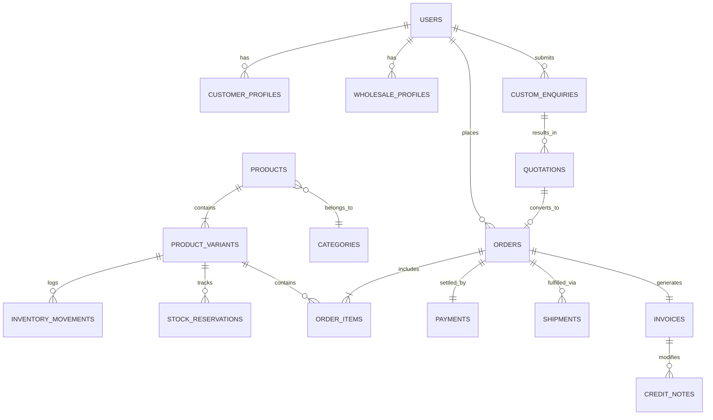

# Jain Sarafa Thella — V2 Integrated Implementation Plan — Reviewed

**Document Identifier:** `V2 Integrated Implementation Plan — Reviewed`  
**File Location:** `d:\shikher sih\JST_APP\V2_INTEGRATED_IMPLEMENTATION_PLAN.md`  
**Version:** 2.1.0-Reviewed  
**Effective Date:** 25 October 2026  
**Business Location:** Agra, Uttar Pradesh, India  
**Project Character:** Premium Retail + Wholesale + Bespoke Bag Manufacturing E-Commerce Platform  
**Operational Status:** **PLANNING ONLY — PENDING OWNER AUTHORIZATION BEFORE IMPLEMENTATION**

---

## 1. Executive Summary and Strategic Alignment

### 1.1 Business Background
Jain Sarafa Thella is a long-standing physical packaging and bag manufacturer based in the commercial sarafa (jewellery) trading market of Agra, Uttar Pradesh. The business specializes in jewellery pouches (velvet, satin, suede potlis), retail shopping thellas (cotton, canvas, non-woven), and high-volume customized corporate/wedding packaging. The company is transitioning from a purely brick-and-mortar storefront to an integrated dual-channel enterprise: serving walk-in counter customers in Agra while launching a unified digital platform for retail consumers, regional wholesale shopkeepers, and bespoke corporate clients across India.

### 1.2 Core Project Objectives
1. **Unify Three Distinct Market Channels:**
   - **Retail (B2C):** Frictionless buying for end-consumers and gift shoppers with mobile-first checkout, UPI/card/COD payments, and doorstep courier tracking.
   - **Wholesale (B2B):** Verified accounts, tiered volume discounts, strict Minimum Order Quantities (MOQs), bulk ordering, quick reordering, and GST-compliant B2B tax invoicing.
   - **Custom Bag Manufacturing CRM:** Dedicated bespoke workflow for custom dimensions, custom fabrics, screen printing, gold/silver foil stamping, quote revisions, and advance deposit payments.
2. **Harmonize Physical and Online Inventory:** Establish a single operational ledger where counter sales at the physical Agra shop and digital web orders interact safely via atomic reservation locks to eliminate overselling.
3. **Hindi-First Consumer Experience:** Deliver native Hindi (`hi-IN`) as the default storefront and transactional communication language, with seamless toggling to Indian English (`en-IN`) and architectural readiness for progressive Indian language rollouts.
4. **Zero-Trust Financial and Data Architecture:** Separate order, payment, fulfilment, and refund lifecycles. Payment status transitions strictly via authenticated, signed server-to-server webhooks with idempotency tracking.
5. **Cost-Prudent Engineering:** Leverage generous cloud and platform free tiers (Vercel, Supabase, Cloudflare CDN) during development and staging, ensuring commercial expenses scale strictly in proportion to revenue-generating operational volume.
6. **Strict Launch Discipline:** No production deployment occurs until comprehensive end-to-end user acceptance testing (UAT), disaster recovery drills, and professional tax/legal verifications are completed on staging.

---

## 2. Decision Register (Governance & Approval Gates)

The following register documents all pending business, commercial, tax, and legal decisions. In accordance with strict planning governance, **no placeholder or example value is treated as an approved business policy**. Every item below is explicitly **PENDING** formal sign-off.

| Decision ID | Decision Title | Operational Context & Impact | Required Approver | Phase Blocked | Current Status |
| :--- | :--- | :--- | :--- | :---: | :---: |
| **DEC-01** | **Retail Account Policy (Mandatory vs. Guest Checkout)** | Determines whether retail end-consumers must authenticate via mobile OTP/password before purchasing, or if guest checkout is permitted. Balances checkout friction against verified customer tracking and fraud mitigation. | Business Owner | Phase 3 | **PENDING** |
| **DEC-02** | **COD Financial Boundaries & Handling Surcharge** | Establishes the minimum order value, maximum order value, and non-refundable handling fee for retail Cash-on-Delivery. Directly impacts working capital and Return-to-Origin (RTO) cargo risk. | Business Owner | Phase 4 | **PENDING** |
| **DEC-03** | **Inventory Soft-Reservation Timeout Window** | Establishes the exact duration (e.g., candidate 10–15 minutes) an inventory item is locked during checkout before abandoned carts release stock back to the physical shop and other online buyers. | Business Owner & Store Ops | Phase 3 | **PENDING** |
| **DEC-04** | **Wholesale MOQs & Quantity Break Pricing** | Sets the exact Minimum Order Quantities (MOQ) and tiered volume price schedules across bag lines. Must balance wholesale margins against production batch economics. | Business Owner | Phase 0 & 3 | **PENDING** |
| **DEC-05** | **Custom Manufacturing Run & Advance Deposit** | Sets the minimum production run for bespoke printed bags and the mandatory upfront non-refundable deposit percentage (e.g., candidate 50%). Protects against custom inventory abandonment. | Business Owner | Phase 3 | **PENDING** |
| **DEC-06** | **Retail Return Window & Customer Freight Policy** | Establishes the return window (e.g., candidate 7 days) and whether return reverse-shipping freight is absorbed by the store or deducted from customer refunds. | Business Owner & Legal | Phase 0 & 4 | **PENDING** |
| **DEC-07** | **GST HSN Classification & Tax Rate Schedule** | Formal legal assignment of HSN codes (e.g., 4202 vs. 6305) and tax rates (5%, 12%, or 18%) for specific bag materials, and determination of E-invoicing applicability. | Chartered Accountant | Phase 0 & 4 | **PENDING** |
| **DEC-08** | **Consumer Protection & DPDP Compliance Setup** | Formal appointment of resident Grievance Officer, publication of physical Agra address, country of origin disclosures, and DPDP privacy notices. | Legal Counsel / Owner | Phase 0 & 5 | **PENDING** |
| **DEC-09** | **Payment Gateway & Logistics Aggregator Selection** | Final contract execution with payment gateway (Razorpay vs. Cashfree) and logistics aggregator (Shiprocket vs. Delhivery Direct), confirming commercial rates and COD remittance cycles. | Business Owner | Phase 4 | **PENDING** |
| **DEC-10** | **WhatsApp BSP & Communication Budget** | Selection of official WhatsApp Business Solution Provider (Direct Cloud API vs. BSP such as Gupshup/Wati) and recurring monthly communication cost approval. | Business Owner | Phase 5 | **PENDING** |

---

## 3. Requirement Categorization Framework

To prevent unapproved assumptions from being mistaken for binding commitments, all specifications are categorized into one of four governance tiers:

```
┌───────────────────────────────────────────────────────────────────────────────────┐
│                      Requirement Governance Classification                        │
├─────────────────────────────────────┬─────────────────────────────────────────────┤
│ 1. Confirmed Business Requirements  │ Non-negotiable core pillars locked by the   │
│                                     │ business charter.                           │
├─────────────────────────────────────┼─────────────────────────────────────────────┤
│ 2. Recommended Features             │ Industry best-practice capabilities         │
│                                     │ proposed to optimize operations & UX.       │
├─────────────────────────────────────┼─────────────────────────────────────────────┤
│ 3. Assumptions Requiring Approval   │ Operational thresholds, fees, timers, and   │
│                                     │ policies needing owner sign-off.            │
├─────────────────────────────────────┼─────────────────────────────────────────────┤
│ 4. Verification Required            │ Statutory tax, legal, regulatory, or vendor │
│                                     │ terms requiring licensed professionals.     │
└─────────────────────────────────────┴─────────────────────────────────────────────┘
```

### 3.1 Confirmed Business Requirements (CBR)
* **CBR-01 (Store Profile):** Physical shop located in Agra, Uttar Pradesh, combined with an e-commerce website for bag sales.
* **CBR-02 (Catalog Size):** Initial product catalog encompassing approximately 50–200 bag SKUs.
* **CBR-03 (Customer Personas):** Unified platform serving Retail (B2C), Wholesale (B2B), and Custom Manufacturing clients.
* **CBR-04 (Hindi-First Storefront):** Hindi (`hi-IN`) as the default language for storefront browsing, product specs, cart, checkout, and system alerts, with toggle to English (`en-IN`) and progressive readiness for additional Indian languages.
* **CBR-05 (Payment Methods):** Support for UPI, debit/credit cards, net banking, mobile wallets, retail Cash-on-Delivery (COD), and bank advance transfers.
* **CBR-06 (Strict Retail-Only COD):** Cash-on-Delivery is strictly prohibited for wholesale and custom manufacturing orders.
* **CBR-07 (Wholesale Segregation):** Wholesale accounts require registration and manual admin verification; tiered volume pricing and MOQs are hidden from unapproved visitors.
* **CBR-08 (Custom Manufacturing CRM):** Dedicated pipeline for bespoke bag enquiries with custom dimensions, material choices, and artwork uploads.
* **CBR-09 (Quotations Engine):** Formal quotation generation with status tracking (`New → Under Review → Quoted → Negotiation → Accepted / Rejected / Expired`) and quote-to-order conversion.
* **CBR-10 (Shared Inventory):** Real-time stock harmonization between the physical Agra shop counter and online sales to prevent overselling.
* **CBR-11 (Official WhatsApp Integration):** Order and dispatch notifications delivered via the official WhatsApp Business Platform API with explicit customer opt-in.
* **CBR-12 (GST-Compliant Invoicing):** Generation of legal B2C retail invoices, B2B tax invoices with buyer GSTIN, and credit notes for returns.
* **CBR-13 (Admin Governance):** Role-Based Access Control (RBAC) with immutable audit logs for sensitive stock, price, and refund operations.
* **CBR-14 (Staging-First Launch):** Zero production deployment until end-to-end acceptance testing and disaster recovery drills are verified in staging.

### 3.2 Recommended Architectural & Operational Features (REC)
* **REC-01 (Modular Monolith Architecture):** Next.js 14+ full-stack architecture with TypeScript and server actions, eliminating the operational complexity and cost of microservices while maintaining strict domain modularity.
* **REC-02 (Zero-Trust Payment Webhooks):** Decoupling payment state updates from browser redirects, requiring signed HMAC-SHA256 server-to-server webhook confirmation with idempotency tracking.
* **REC-03 (Automated Courier Integration):** Direct integration with Shiprocket (or equivalent aggregator) for automated rate comparison, live AWB assignment, 4x6" shipping label generation, and tracking webhook consumption.
* **REC-04 (Automated NDR Triage):** Automated WhatsApp interactive alerts for courier Non-Delivery Reports (NDR) to allow buyers to confirm addresses or reschedule delivery, mitigating RTO expenses.
* **REC-05 (CSV Bulk Catalog Operations):** Administrative import/export engine for bulk pricing and inventory adjustments with pre-commit schema validation and SKU uniqueness checks.
* **REC-06 (B2B Quick Reorder):** Wholesale interface enabling one-click re-population of previous orders with real-time stock and price revalidation.
* **REC-07 (Automated Backup & Recovery Drills):** Automated daily database snapshots with a documented 60-minute Point-in-Time Recovery (PITR) drill executed on staging.

### 3.3 Assumptions Requiring Business Owner Approval (ASM)
* **ASM-01 (Customer Account Mandate - DEC-01):** *Working assumption:* Customer accounts are mandatory for wholesale and custom orders, while retail allows mobile OTP-verified checkout. *Requires owner decision on whether guest checkout without persistent account is permitted.*
* **ASM-02 (COD Thresholds & Fee - DEC-02):** *Placeholder values:* Minimum order ₹499, maximum order ₹3,000, and non-refundable ₹49 handling fee. *Requires owner policy sign-off.*
* **ASM-03 (Inventory Reservation Timeout - DEC-03):** *Placeholder value:* 15-minute soft lock during checkout. *Requires owner validation based on store peak footfall.*
* **ASM-04 (Wholesale MOQs - DEC-04):** *Placeholder values:* 50 pieces for small pouches, 100 pieces for printed cotton bags. *Requires owner validation against production runs.*
* **ASM-05 (Custom Order Minimums & Deposit - DEC-05):** *Placeholder values:* Minimum 250 pieces and 50% non-refundable advance deposit. *Requires owner validation against tooling/screen setup costs.*
* **ASM-06 (Retail Return Window - DEC-06):** *Placeholder value:* 7 calendar days for transit damage or manufacturing defects only. *Requires owner policy approval.*
* **ASM-07 (Infrastructure Cost Ceilings):** *Placeholder assumption:* Zero-cost development on free tiers (Vercel, Supabase, Cloudflare), with paid tiers triggered only when commercial thresholds are exceeded. *Requires owner budget approval.*
* **ASM-08 (Performance & Availability Targets):** *Placeholder targets:* 99.9% uptime during 08:00–22:00 IST; 500 concurrent browsing users and 50 concurrent checkouts. *Requires owner confirmation of scale expectations.*

### 3.4 Items Requiring Professional, Legal, or Provider Verification (VER)
* **VER-01 (GST & HSN Tax Classification - DEC-07):** Verification of exact HSN codes (e.g., 4202 for pouches/cases vs. 6305 for textile packaging sacks) and applicable GST rates (5%, 12%, or 18% depending on fabric composition and value). *Requires formal sign-off by a licensed Chartered Accountant.*
* **VER-02 (E-Invoicing Applicability):** Determining whether Jain Sarafa Thella’s Aggregate Annual Turnover (AATO) exceeds ₹5 crore in any financial year from 2017–18 onwards, mandating B2B Invoice Registration Portal (IRP) integration. *Requires Chartered Accountant audit.*
* **VER-03 (E-Commerce Consumer Protection Compliance - DEC-08):** Formal appointment of a resident Grievance Officer, publication of full geographic entity details, and display of Country of Origin on every product listing. *Requires legal review under Consumer Protection (E-Commerce) Rules, 2020.*
* **VER-04 (Data Privacy Notice & Consent):** Deployment of standalone, plain-language consent notices, user data export, and account deletion workflows compliant with the Digital Personal Data Protection Act, 2023 and DPDP Rules, 2025. *Requires legal review.*
* **VER-05 (Payment Gateway Merchant Agreement - DEC-09):** Merchant onboarding, KYC verification, MDR fee schedule (0% UPI, card rates), and automated refund settlement rules with Razorpay/Cashfree. *Requires payment provider contract execution.*
* **VER-06 (Courier Serviceability & Remittance - DEC-09):** Verification of courier aggregator API capabilities, COD cash remittance cycles (T+2 to T+7 days), and loss/damage compensation terms. *Requires logistics provider verification.*
* **VER-07 (Meta WhatsApp Template Compliance - DEC-10):** Pre-submission and approval of utility and authentication message templates with Meta, and confirmation of per-delivered-message charges. *Requires BSP/Meta verification.*

---

## 4. Statutory, Legal, and Provider Verification Baseline

All external legal, taxation, privacy, and third-party provider claims are grounded in authoritative documentation verified as of 25 October 2026:

### 4.1 Indian GST and Invoicing Compliance
* **Authority:** Central Board of Indirect Taxes and Customs (CBIC), Ministry of Finance, Government of India ([cbic.gov.in](https://www.cbic.gov.in)).
* **Notification No. 10/2023–Central Tax (Dated 10 May 2023, Effective 1 August 2023):**
  * Mandates electronic invoicing (e-invoicing) for registered taxpayers whose **Aggregate Annual Turnover (AATO) exceeded ₹5 crore** in any single financial year from 2017–18 onwards.
  * **Scope:** Applies strictly to Business-to-Business (B2B) supplies, exports, and credit/debit notes. Invoices must be registered on the Invoice Registration Portal (IRP) to generate a valid Invoice Reference Number (IRN) and signed QR code.
  * **B2C Retail Exemption:** Under Rule 48(4) of the CGST Rules, 2017, **B2C retail invoices are explicitly excluded from e-invoicing**.
  * **Dynamic QR Code on B2C Invoices:** Mandated only for entities with AATO exceeding ₹500 crore (Notification No. 14/2020–Central Tax); does not apply to JST.
* **Statutory Invoice Standards (Rule 46, CGST Rules, 2017):**
  * Sequential, unique serial numbering per financial year (e.g., `JST/2026-27/0001`).
  * Explicit customer name, delivery address, state code, and verified 15-character GSTIN for B2B transactions.
  * HSN code, taxable value, and clear bifurcation of CGST + SGST (intra-state UP, place of supply `09`) vs. IGST (inter-state supplies).
* **Credit Notes (Rule 53, CGST Rules, 2017):** Must explicitly reference the original invoice number, original date of issue, taxable value adjusted, and tax credit adjustment.
* *Professional Action Required:* Chartered Accountant must formally certify JST's turnover relative to the ₹5 crore threshold and supply certified HSN/tax percentage tables before code locks.

### 4.2 Consumer Protection (E-Commerce) Rules, 2020
* **Authority:** Ministry of Consumer Affairs, Food and Public Distribution, Government of India ([consumeraffairs.gov.in](https://consumeraffairs.gov.in)).
* **Gazette Notification G.S.R. 462(E) (Dated 23 July 2020):** Notified under the Consumer Protection Act, 2019. Mandates:
  1. **Platform Entity Disclosures:** Prominent display of legal entity name, full geographic headquarters address in Agra, customer support telephone, and official email.
  2. **Resident Grievance Officer:** Formal appointment of a Grievance Officer resident in India. Officer's name, designation, and direct contact details must be published on the platform.
  3. **Grievance Redressal Timelines:** Statutory requirement to acknowledge consumer complaints within **48 hours** and fully resolve complaints within **1 month** of receipt.
  4. **Pre-Purchase Pricing Transparency:** Displaying the total price in a single figure alongside an itemized breakdown of base cost, GST taxes, freight, and optional fees.
  5. **Country of Origin:** Pre-purchase declaration of Country of Origin on every product detail page (e.g., *"Country of Origin: India"*).

### 4.3 Digital Personal Data Protection (DPDP) Act, 2023 & DPDP Rules, 2025
* **Authority:** Ministry of Electronics and Information Technology (MeitY), Government of India ([meity.gov.in](https://www.meity.gov.in)).
* **Statutory Baseline & Phased Implementation Status:**
  * **Currently in Force:** Foundational administrative sections, definitions, rule-making powers, and the establishment of the **Data Protection Board of India (DPBI)** following the gazette notifications on **13–14 November 2025**.
  * **Phased Roadmap for Commercial Data Fiduciaries:** Substantive operational mandates—including Consent Manager operationalization, full data audit frameworks, and formal 72-hour breach notification procedures—are subject to government-notified transition windows (extending through 2026–2027). The platform proactively implements bilingual privacy notices, unbundled consent, and data rights endpoints ahead of statutory enforcement deadlines.
* **Statutory Tax Retention vs. Right to Erasure (Interplay Requiring CA/Legal Review):**
  * Data Principals possess the right to erasure of personal data that is no longer necessary for processing.
  * **Statutory Override:** Section 36 of the Central Goods and Services Tax (CGST) Act, 2017 mandates that every registered taxable person maintain accounts, financial records, and tax invoices for a minimum of **72 months (6 years)** from the due date of filing the annual return.
  * **Reconciled Platform Logic:** When a customer requests data deletion via `/api/user/data-deletion`, profile identifiers and marketing preferences are permanently anonymized/erased, while statutory financial invoices, credit notes, and associated billing details are moved into a **locked, read-only compliance archive** until the 72-month tax audit period expires. Formal legal/CA certification required.

### 4.4 Payment Gateway Provider (Razorpay)
* **Authority:** Razorpay Developer Documentation ([razorpay.com/docs](https://razorpay.com/docs/payments/payment-gateway/webhooks/)).
* **Zero-Trust Webhook Architecture:**
  * Webhook payloads are delivered with an `X-Razorpay-Signature` HTTP header.
  * Backend must calculate an `HMAC-SHA256` signature using the **raw, unparsed request body** and the configured webhook secret.
  * Signature comparison must use timing-safe string comparison (e.g., `crypto.timingSafeEqual`) to prevent timing attacks.
  * Standard commercial model: 0% MDR on UPI (under NPCI rules); ~2% + GST for domestic credit/debit cards and net banking, subject to merchant agreement.

### 4.5 Logistics Aggregator Provider (Shiprocket)
* **Authority:** Shiprocket Developer API Documentation ([shiprocket.in](https://shiprocket.in)).
* **API Capabilities Confirmed:**
  * Authentication: `POST /v1/external/auth/login` returning Bearer JWT.
  * Serviceability & Rates: `GET /v1/external/courier/serviceability/` passing pickup and delivery pincodes, weight, and COD flag.
  * AWB Generation: `POST /v1/external/courier/assign/awb`.
  * Label Generation: `POST /v1/external/courier/generate/label` returning downloadable 4x6" PDF.
  * Real-Time Tracking: `GET /v1/external/courier/track/awb/{awb_code}` and incoming webhook events.
  * NDR (Non-Delivery Reports): `GET /v1/external/ndr/all` and action endpoints for automated re-attempts.
  * *Commercial Dependency:* COD cash remittance cycles (typically T+2 to T+7 days post-delivery) must be incorporated into cash flow planning.

### 4.6 Meta WhatsApp Business Platform (Cloud API)
* **Authority:** Meta WhatsApp Business Platform Documentation & Rate Card ([business.whatsapp.com](https://business.whatsapp.com)).
* **India (+91) Pricing Mechanics (Excl. 18% GST):**
  * **Utility Templates (Order Confirmed, Dispatched, Tracking):** ~₹0.1150 per delivered message.
  * **Authentication Templates (OTPs):** ~₹0.1150 per delivered message.
  * **Marketing Templates (Offers, Festival Promotions):** ~₹0.8631 per delivered message.
  * **Service Conversations (Customer Inbound Queries):** First 1,000 conversations per month are free; subsequent conversations charged at ~₹0.1150.
  * *Operational Rules:* Meta charges strictly on a **delivered basis**. Marketing messages do not qualify for volume tier discounts. Business Solution Providers (BSPs) charge additional platform or per-message markups.

---

## 5. Customer-Facing Storefront & Product Catalogue

### 5.1 Bilingual Hindi-First UX Architecture (CBR-04)
* **Default Locale:** Hindi (`hi-IN`) across all customer journeys.
* **Secondary Locale:** Indian English (`en-IN`), accessible via a persistent header toggle.
* **Translation Mechanics:** Static UI text mapped to structured dictionary files (`/locales/hi.json`, `/locales/en.json`). Dynamic database items utilize bilingual JSONB structures:
  ```json
  {
    "title": { "hi": "शाही लाल मखमली आभूषण थैला", "en": "Royal Red Velvet Jewellery Pouch" },
    "description": { "hi": "सोने-चांदी के आभूषणों हेतु प्रीमियम थैला...", "en": "Premium pouch for gold and silver jewellery..." }
  }
  ```
* **Search & Transliteration:** Elastic full-text search matching Devanagari Hindi, Latin English, and colloquial Indian terminology (e.g., "potli", "thella", "thaila", "sarafa bag", "batwa").

### 5.2 Product Attribute Model & Catalogue Matrix (50–200 SKUs)
Each bag product record supports the following attribute matrix:
```
Product (Base Model)
 ├── Base SKU & Master Title (Hindi & English)
 ├── Category & Subcategory Taxonomy (Sarafa Pouches, Shopping Thellas, Gift Boxes)
 ├── Product Type: [Ready-Stock | Made-to-Order | Custom-Only]
 ├── Fabric / Material: [Velvet, Jute, 100% Cotton, Canvas, Non-Woven, Satin]
 ├── Fabric GSM: [80 GSM, 120 GSM, 250 GSM, 400 GSM]
 ├── Dimensions: [Length x Width x Gusset (in cm / inches)]
 ├── Handle Type: [D-Cut, Loop Handle, Cotton Rope, Gold Drawstring, Ribbon]
 ├── Country of Origin: "India" (Statutory disclosure)
 ├── HSN Code & GST Rate %: (Assigned via CA certification under DEC-07)
 ├── Variants Matrix:
 │    ├── Variant SKU (e.g., JST-VLV-RED-01)
 │    ├── Color / Finish: [Maroon, Royal Blue, Gold, Emerald Green, Natural]
 │    ├── Size: [Small (4x5"), Medium (6x8"), Large (10x12"), Custom]
 │    ├── Retail MRP & Selling Price (₹)
 │    ├── Wholesale Price Tiers (e.g., Tier 1: 50-199 pcs | Tier 2: 200-499 pcs | Tier 3: 500+ pcs)
 │    ├── Minimum Order Quantity (MOQ): Retail = 1; Wholesale = (Set under DEC-04)
 │    ├── Physical Stock Count & Soft-Reserved Stock Count
 │    └── High-Resolution Images (Responsive WebP formats)
 └── SEO Metadata (JSON-LD structured data, meta titles/descriptions)
```

### 5.3 Administrative CSV Bulk Operations (REC-05)
* **Bulk Upload / Export Engine:** CSV utility for rapid catalog synchronization:
  * Bulk creation, pricing tier adjustments, and inventory reconciliation.
  * Pre-commit validation: Rejects files with missing mandatory headers, duplicate SKUs, negative prices, or unmapped HSN codes.
  * Error reporting: Outputs detailed error logs indicating exact row numbers and validation failure reasons.
* **Audit Trail:** Every bulk CSV upload records timestamp, admin user ID, imported filename, total rows processed, and rows altered.

---

## 6. Retail Checkout and Customer Accounts

### 6.1 Reconciled Account Policy & Architecture Decoupling (DEC-01)
* **Wholesale Buyers & Custom Clients:** **Mandatory Account Creation.** Requires verified phone/email, business credentials, and admin approval. Guest checkout is completely blocked.
* **Retail Buyers (Pending Owner Decision DEC-01):**
  * **Status:** DEC-01 remains **strictly PENDING** business owner approval. The architecture must not prematurely force a retail account policy.
  * *Option A (Mandatory Light Account):* User authenticates via quick WhatsApp/SMS OTP before entering address. Benefits: Verified phone number, zero forgotten passwords, guaranteed order tracking history, reduced COD fraud.
  * *Option B (Guest Checkout Permitted):* User enters address and phone without creating an account; system creates a shadow customer record linked to the phone number. Benefit: Maximizes first-time checkout conversion.
  * *Architectural Decoupling Safeguard:* In the database schema, `orders.user_id` is defined as **strictly nullable** (`user_id UUID NULL`). Checkout APIs accept an optional `guest_checkout: true` flag. If the owner approves guest checkout, orders proceed with phone linkage; if mandatory accounts are chosen, the UI enforces the OTP login modal before address entry with zero underlying database refactoring.

### 6.2 Retail Checkout Funnel
The checkout flow is structured as a linear 4-step pipeline:
1. **Step 1: Cart Review & Stock Lock:** Cart validates live inventory and initiates an atomic soft-reservation lock (duration governed by DEC-03).
2. **Step 2: Shipping Address & Serviceability:** Validates delivery pincode via Shiprocket API to verify delivery feasibility and calculate live freight.
3. **Step 3: Tax Calculation:** Dynamically bifurcates Intra-state (CGST + SGST for Uttar Pradesh) vs. Inter-state (IGST) based on destination state.
4. **Step 4: Payment Authorization:** Directs user to digital gateway session (Razorpay) or Cash-on-Delivery (if criteria are met under DEC-02).

---

## 7. Wholesale Portal, MOQ and Tiered Pricing

### 7.1 Wholesale Verification Engine (CBR-07)
1. **Registration:** Buyer submits Business Name, Trade Name, GSTIN, PAN, Storefront/Business Card photo, Contact Person, and Expected Monthly Volume.
2. **Backoffice Verification:** Store admin reviews business legitimacy and elevates user role from `retail_customer` to `wholesale_buyer`.
3. **Restricted Visibility:** Unapproved visitors never see wholesale price breaks or MOQ constraints.

### 7.2 Tiered Pricing & Minimum Order Quantity (MOQ) (DEC-04)
* **Server-Side Enforcement:** Wholesale rules are strictly validated on the server API; client-side price tampering is impossible.
* **Quantity Breaks Matrix:** Exact volume tiers and MOQs will be finalized under DEC-04. Example candidate structure:
  * Small Velvet Jewellery Pouch: Retail = 1 pc; Wholesale Tier 1 (50–199 pcs); Tier 2 (200–499 pcs); Tier 3 (500+ pcs); MOQ = 50 pcs.
* **Cart Validation Rules:** If a wholesale customer adds an item below MOQ, the system prevents checkout: *"इस उत्पाद के लिए न्यूनतम थोक ऑर्डर मात्रा {MOQ} पीस है।"*
* **Payment Restriction:** Wholesale orders are **strictly disqualified from Cash-on-Delivery (COD)**.

### 7.3 Wholesale Quick Reorder (REC-06)
Wholesale buyers can open past order history and click "त्वरित पुनः ऑर्डर" (Quick Reorder). The system re-populates the cart, re-validates live stock and active pricing tiers, alerts the user of any discontinued SKUs, and transitions directly to checkout.

---

## 8. Quotations and Custom-Manufacturing CRM

### 8.1 Custom Manufacturing Enquiry Pipeline (CBR-08)
For custom-printed bags (e.g., jeweller's brand name stamped in gold foil on velvet pouches), clients submit technical specifications:
1. Base Bag Model or Custom Form Factor.
2. Exact Dimensions: Height x Width x Bottom Gusset x Side Gusset (cm/inches).
3. Fabric Material & Color Shade (with pantone/swatch references).
4. Branding Details: Logo placement, printing technique (Screen printing, Heat transfer, Gold/Silver foil stamping, Embroidery).
5. Desired Order Quantity (Minimum production run governed by DEC-05).
6. Delivery Deadline / Target Event Date.
7. Secure Multi-File Artwork Uploads (.ai, .eps, .pdf, .png) stored in private object storage with signed URL access.

### 8.2 Quotation Management Lifecycle (CBR-09)
Inside the Admin CRM, quotations traverse strict operational states:
$$\text{New} \longrightarrow \text{Under Review} \longrightarrow \text{Quoted} \longrightarrow \text{Negotiation/Revision} \longrightarrow \text{Accepted} \longrightarrow \text{Production Order}$$
*(or terminal states: Rejected / Expired)*.

* **Revisions:** Any requested modification generates a child revision `Q-1002-R1` referencing `parent_quote_id`, archiving prior terms.
* **Quote-to-Order Conversion:** Digital acceptance locks unit pricing and generates an advance payment invoice (deposit % governed by DEC-05) and an Agra factory production job card detailing cutting dimensions, fabric yardage, printing screen block specs, and dispatch deadline.

---

## 9. Ready-Stock and Made-to-Order Inventory

### 9.1 Shared Physical & Online Inventory Ledger (CBR-10)
```
                               ┌────────────────────────────────┐
                               │   Master Inventory Ledger      │
                               └──────────────┬─────────────────┘
                                              │
                     ┌────────────────────────┴────────────────────────┐
                     ▼                                                 ▼
      ┌─────────────────────────────┐                   ┌─────────────────────────────┐
      │   Physical Counter Sales    │                   │   Online Storefront Sales   │
      └──────────────┬──────────────┘                   └──────────────┬──────────────┘
                     │                                                 │
          [ Point of Sale Touch ]                          [ Add to Cart & Checkout ]
                     │                                                 │
          Instant Hard Deduction                           Soft Reservation Lock (DEC-03)
                     │                                                 │
                     └────────────────► Atomic DB Update ◄─────────────┘
                                   (Oversell Protection Lock)
```

1. **Atomic Soft Reservation (Prepaid Orders):** Proceeding to checkout places an atomic reservation lock on the inventory row for a defined duration (governed by DEC-03).
   - If payment fails, checkout is abandoned, or reservation timer expires: background cron transitions reservation to `status: released`. Available stock immediately increments without manual intervention.
   - If payment succeeds: verified webhook transitions reservation to `status: converted`. Stock is permanently deducted from warehouse inventory (`reason_code: prepaid_order_placed`).
   - If prepaid customer cancels pre-dispatch: stock is immediately restored to available inventory (`reason_code: prepaid_cancellation_restock`) and gateway refund is triggered.
   - If prepaid parcel faces delivery failure / RTO: stock **cannot be automatically restocked**. It remains in `in_transit_rto` status until the physical package arrives back at the Agra warehouse, undergoes staff inspection for seal/packaging damage, and is manually accepted via inward audit entry (`reason_code: rto_verified_restock`).

2. **Immediate Allocation (COD Orders):**
   - Customer submits order and completes WhatsApp/SMS OTP verification.
   - Because there is no gateway session, OTP verification immediately places the stock into `allocated_for_dispatch` status (`reason_code: cod_order_placed`), immediately preventing physical counter POS and other online buyers from selling these units.
   - Pre-dispatch cancellation: allocated stock returns immediately to sellable pool (`reason_code: cod_cancellation_restock`).
   - Delivery failure / rejection / RTO: stock remains locked in `rto_in_transit`. Stock is restored to available inventory **only after the physical parcel returns to the Agra shop, is inspected, and is formally accepted** (`reason_code: cod_rto_verified_restock`).

3. **Physical Counter Priority:** Shop staff have an internal quick-deduct interface to log immediate offline counter sales, ensuring online customers cannot buy stock that just walked out of the store.

### 9.2 Inventory Classification & Movement Audits
* **Ready-Stock (तत्काल उपलब्ध):** Items physically stitched, shelved, and packaged in Agra; dispatched within 24–48 hours.
* **Made-to-Order (ऑर्डर पर निर्माण):** Standard models stitched on-demand; displays dynamic manufacturing lead times on PDP (e.g., 5–7 working days).
* **Stock Movement Audit Log:** Every inventory increment or decrement records Timestamp, SKU, Quantity Delta (+/-), Reason Code (`online_order`, `counter_sale`, `production_inward`, `prepaid_cancellation_restock`, `cod_cancellation_restock`, `rto_verified_restock`, `damage`), Reference ID, and Staff User ID.

---

## 10. Payments, COD, Shipping and Fulfilment

### 10.1 Zero-Trust Payment Architecture (REC-02)
* Browser redirects to `/thank-you` or `/order-status` set the local view state to **"Payment Verification Pending"**.
* Order status transitions to `PAID` **strictly upon receipt and verification of an authentic server-to-server webhook**.
* **HMAC Signature Verification:** Webhooks are verified against the gateway secret using `HMAC-SHA256` (verifying `X-Razorpay-Signature`).
* **Idempotency Guarantee:** Payloads are hashed and verified against an `idempotency_keys` table. Duplicate webhook deliveries return `HTTP 200 OK` immediately without duplicating stock deductions or alerts.
* **Normalized 1:N Payment Attempts Architecture:**
  - An order may encounter multiple payment failures (e.g., UPI timeout, card decline) before eventual success.
  - Rather than overwriting a flat record, every transaction creates a sequential `payment_attempts` record (`attempt_number`, `gateway_name`, `gateway_payment_id`, `amount`, `attempt_status: initiated | pending_verification | captured | failed | expired`, `error_code`, `error_description`).
  - Webhooks correlate to the exact attempt via `gateway_order_id` and idempotency hash, providing complete auditability for customer disputes.
* **Dedicated Refunds Lifecycle:**
  - Partial or full refunds (pre-dispatch cancellation, damage claim, or return) are managed via a dedicated `refunds` table linked to both the `payment_attempt_id` and the statutory `credit_note_id`.
  - Tracks `refund_status: pending | processed | failed`, gateway refund reference, and authorizing admin staff ID.
* **Independent Lifecycle States:**
  * `order_status`: `draft` → `pending_payment` → `confirmed` → `processing` → `dispatched` → `delivered` → `cancelled` / `returned`.
  * `payment_status`: `unpaid` → `partially_paid` (custom deposit) → `paid` → `partially_refunded` → `fully_refunded`.
  * `fulfilment_status`: `unfulfilled` → `label_generated` → `manifested` → `in_transit` → `out_for_delivery` → `delivered` → `ndr_pending` → `rto`.

### 10.2 Cash-on-Delivery (COD) Risk Controls (CBR-06, DEC-02)
1. **Wholesale & Custom Prohibition:** COD is strictly hidden and disabled if the cart contains wholesale-tiered or custom production items.
2. **Financial Boundaries (Governed by DEC-02):** Enforces minimum and maximum allowable order totals for COD (candidate example: ₹499 to ₹3,000).
3. **Pincode Risk Verification:** Real-time API check queries courier database to exclude blacklisted high-RTO delivery clusters.
4. **OTP Verification:** 4-digit verification code sent via WhatsApp/SMS before a COD order enters the dispatch queue.
5. **Non-Refundable Handling Fee (Governed by DEC-02):** Optional small surcharge (candidate example: ₹49) to cover additional courier cash-handling costs and encourage UPI prepayments.

### 10.3 Courier Integration, NDR and Fulfilment Logistics (REC-03, REC-04)
* **Automated Dispatch:** Admin clicks "Generate Shipping Label"; platform calls Shiprocket API to assign courier, fetch AWB number, and download a standard 4x6" printable shipping label.
* **Live Tracking Webhooks:** Courier pushes delivery milestone events directly to `/api/webhooks/courier`, updating tracking timelines and triggering automated WhatsApp notifications.
* **Non-Delivery Report (NDR) Management:** When delivery fails, the system ingests an NDR event and automatically sends an interactive WhatsApp message prompting the buyer to re-confirm their delivery address or select a re-delivery date.
* **Manual Dispatch Fallback:** If the courier aggregator API experiences downtime, administrators can switch to manual fulfilment mode, entering the courier name, manual AWB, and tracking URL without interrupting sales.

---

## 11. GST, Invoices, Returns and Refunds

### 11.1 GST Invoicing Architecture (CBR-12, DEC-07)
* **Place of Supply Origin:** Agra, Uttar Pradesh (State Code: `09`).
* **Tax Splitting Algorithm:**
  * **Intra-State Supply (Shipping within UP):** Total GST split equally into **CGST** and **SGST** (e.g., 5% GST = 2.5% CGST + 2.5% SGST).
  * **Inter-State Supply (Shipping outside UP):** Total GST levied as **IGST** (e.g., 5% or 12% IGST).
* **Tax Invoice Generation:** Automated generation of downloadable PDF tax invoices complying with Rule 46 of the CGST Rules, 2017. B2B invoices display buyer's legal name, billing address, and verified 15-character GSTIN.

### 11.2 Returns, Cancellations, and Credit Notes (DEC-06)
* **Return Window:** Retail ready-stock return period (governed by DEC-06) applies to verified manufacturing defects or transit damage.
* **Exclusions:** Custom-manufactured bags, personalized branded products, and bulk wholesale lots are non-returnable once dispatched, except for verified production defect against approved master sample.
* **Credit Notes:** Approved returns trigger an automated GST Credit Note complying with Rule 53 of the CGST Rules, 2017, referencing the original invoice serial number. Refunds are processed via original gateway API within 5–7 banking days.
* **Accountant Sign-Off Gate:** Mandatory formal certification of tax algorithms, HSN mappings, and invoice templates by a Chartered Accountant prior to launch.

---

## 12. Admin Dashboard and Staff Permissions

### 12.1 Administrative Control Center
Unified responsive web portal for store operations: Executive Metrics, Catalog Manager, Order & Dispatch Hub, Quotation & Bespoke CRM, Customer Registry, and Financial Reconciliation Ledger.

### 12.2 Role-Based Access Control (RBAC) Matrix (CBR-13)
Permissions are enforced at the server API layer:

| Feature / Operation | Super Admin (Owner) | Store Ops Manager | Sales / Quote Rep | Packaging & Dispatch | External Accountant |
| :--- | :---: | :---: | :---: | :---: | :---: |
| **Manage Staff Roles & System Config** | Yes | No | No | No | No |
| **View Profitability & Executive Metrics**| Yes | No | No | No | Read-Only |
| **Create & Edit Products / Prices** | Yes | Yes | No | No | No |
| **Adjust Inventory Levels** | Yes | Yes | No | Read-Only | No |
| **Approve Wholesale Accounts** | Yes | Yes | No | No | No |
| **Create & Revise Custom Quotes** | Yes | Yes | Yes | No | No |
| **Print Shipping Labels & Pack Orders** | Yes | Yes | No | Yes | No |
| **Authorize Refunds & Issue Credit Notes**| Yes | No | No | No | Yes |
| **Download GST Invoices & Tax Reports** | Yes | Yes | No | No | Yes |
| **View Customer Personal Data** | Full | Masked Phone | Masked Phone | Address Only | Billing Only |

### 12.3 Immutable Audit Logging & Tamper-Proof Protections
Any high-risk administrative action records: Timestamp (UTC & IST), Staff User ID, Action Type (`PRICE_OVERRIDE`, `STOCK_ADJUSTMENT`, `REFUND_ISSUED`, `ROLE_MODIFIED`, `WHOLESALE_APPROVAL`), Target Entity (SKU, Order, User), Old vs. New JSON snapshot, Client IP Address, and User-Agent.

* **Tamper-Proof Protection Architecture:**
  1. **Append-Only Database Grants:** Application database roles are granted **strictly `INSERT` and `SELECT`** permissions on `audit_logs`. `UPDATE`, `DELETE`, `TRUNCATE`, and `DROP` are explicitly **REVOKED**.
  2. **Database Engine Trigger:** A PostgreSQL trigger (`trg_prevent_audit_log_modification`) raises an exception on any attempt to update or delete rows:
     ```sql
     CREATE OR REPLACE FUNCTION prevent_audit_log_modification()
     RETURNS TRIGGER AS $$
     BEGIN
       RAISE EXCEPTION 'Audit log entries are immutable. Modifications and deletions are forbidden.';
     END;
     $$ LANGUAGE plpgsql;
     ```
  3. **Row-Level Security (RLS):** Regular staff cannot inspect logs outside their operational domain; super admins possess read-only visibility.
  4. **Offsite Streaming:** Audit log records are streamed asynchronously to write-once cloud storage (e.g., S3/R2 with Object Lock), ensuring historical logs survive even catastrophic primary database compromises.

---

## 13. WhatsApp, Notifications, Loyalty and Promotions

### 13.1 Official WhatsApp Business Platform API (CBR-11, DEC-10)
* **Transactional Templates (Utility Category):**
  * Order Confirmation & Receipt (ऑर्डर पुष्टि)
  * Dispatch & Live Tracking Link (डिस्पैच और ट्रैकिंग)
  * Quotation Ready for Review (कोटेशन समीक्षा)
  * Custom Job Artwork Proof Approval (नमूना/आर्टवर्क स्वीकृति)
  * Out for Delivery & Delivery Confirmation
* **Opt-In / Opt-Out Protocol:** Explicit opt-in checkbox at checkout. Inbound `STOP` or `रोकें` message automatically revokes marketing broadcast consent.

### 13.2 Promotional Engine
Admin-configurable coupons: Fixed amount off, percentage discount, minimum cart value thresholds, customer-group specific vouchers, and usage caps.

---

## 14. Multilingual Support (Hindi-First Architecture)

* **Default Language:** Hindi (`hi-IN`) across all customer journeys.
* **Secondary Language:** Indian English (`en-IN`), toggled via persistent header switch.
* **Progressive Expansion:** Architectural readiness for Gujarati (`gu-IN`), Marathi (`mr-IN`), Bengali (`bn-IN`), and Telugu (`te-IN`).

---

## 15. Security, Privacy, Observability and Backup Strategy

### 15.1 Technical Security Controls
* Strict Transport Security (HSTS) with TLS 1.3 encryption.
* Parameterized database queries and strict schema validation (Zod schemas) to prevent SQL injection and XSS.
* Secure HTTP-only, SameSite=Strict session cookies.
* Private object storage buckets with time-limited signed URLs (15-minute expiration) for artwork and financial documents.

### 15.2 Privacy & Indian DPDP Act Compliance
* Plain-language bilingual consent notices.
* Machine-readable personal data export endpoint (`/api/user/data-export`).
* Account deletion and anonymization endpoint (`/api/user/data-deletion`), preserving statutory tax invoices for 72 months as required by Section 36 of the CGST Act.
* 72-hour mandatory breach notification procedure to the Data Protection Board of India.

### 15.3 Observability, Backups & Disaster Recovery (REC-07)
* Daily automated database snapshots with Point-in-Time Recovery (PITR).
* Weekly offsite encrypted backup dumps.
* Mandatory pre-launch staging disaster recovery drill: Restoring database from backup within 60 minutes.

---

## 16. SEO, Accessibility and Performance

### 16.1 Search Engine Optimization (SEO)
* Server-Side Rendering (SSR) for all category and product pages.
* Canonical URLs with `hreflang` tags linking Hindi (`hi-IN`) and English (`en-IN`) versions.
* Schema.org JSON-LD structured data: `Product` schema, `BreadcrumbList` schema, and `LocalBusiness` / `Store` schema with Agra geographic coordinates.

### 16.2 Web Performance Benchmarks (Recommended Engineering Targets)
* Largest Contentful Paint (LCP) ≤ 2.5 seconds on 4G mobile networks.
* Interaction to Next Paint (INP) ≤ 200 milliseconds.
* Cumulative Layout Shift (CLS) ≤ 0.1.
* *Note:* Performance metrics represent quality engineering targets to be validated during load testing, not guaranteed vendor SLAs.

### 16.3 Accessibility (a11y)
WCAG 2.1 Level AA compliance: minimum color contrast ratio of 4.5:1, keyboard navigability, semantic ARIA labels, and touch-target sizes ≥ 48x48px on mobile viewports.

---

## 17. Recommended Technical Architecture & Technology Options

```
┌────────────────────────────────────────────────────────────────────────────┐
│                    Next.js 14+ Full-Stack Web App                          │
├─────────────────────────────────────┬──────────────────────────────────────┤
│       Frontend Layer (React)        │         Server Layer (Node.js)       │
│  - Bilingual Storefront (hi/en)     │  - Route Handlers & Server Actions   │
│  - Responsive Mobile Shell          │  - RBAC Middleware & Zod Validation  │
│  - Retail & Wholesale Portals       │  - Zero-Trust Webhook Processors     │
│  - Custom Bag Enquiry Forms         │  - PDF Invoicing Engine (Rule 46)    │
├─────────────────────────────────────┴──────────────────────────────────────┤
│                         Domain Service Modules                             │
│  [Catalog]  [Inventory]  [Checkout]  [Wholesale]  [Quotes]  [Shipping]     │
├────────────────────────────────────────────────────────────────────────────┤
│                       Data & Storage Infrastructure                        │
│  - Managed PostgreSQL (ACID transactions, Row-Level Security, PITR)        │
│  - Private S3-Compatible Object Storage (Artwork, Invoices, Labels)        │
│  - Edge CDN & In-Memory Cache (Static assets, public product listings)     │
└────────────────────────────────────────────────────────────────────────────┘
```

### 17.1 Technology Selection & Evaluation

| Technology Layer | Selected Recommendation | Alternative Candidate | Architectural Justification |
| :--- | :--- | :--- | :--- |
| **Frontend Framework** | **Next.js 14+ (App Router, TypeScript)** | Remix / Vite SPA | Industry standard for SSR/SSG e-commerce SEO, excellent performance, built-in server actions, and active ecosystem. |
| **Styling & Design System** | **Tailwind CSS + Vanilla Design Tokens** | Pure CSS Modules | High-speed mobile-first responsive development; utility classes allow rapid styling with zero bundle bloat; strictly themed with custom sarafa palette. |
| **Database & Auth** | **PostgreSQL (Supabase Managed)** | Neon + Prisma / Self-hosted PG | Rock-solid relational ACID compliance for inventory and financial ledgers; built-in auth, Row-Level Security (RLS), and zero base cost during development. |
| **Object Storage** | **Supabase Storage / Cloudflare R2** | AWS S3 | S3-compatible, private bucket capabilities with signed URL generation; zero egress fees on Cloudflare R2 / generous free tier on Supabase. |
| **Payment Gateway** | **Razorpay (India)** | Cashfree / PhonePe | Market leader in India for UPI Auto-Intent, cards, Net Banking, robust webhook verification, and automated refund APIs. |
| **Logistics Provider** | **Shiprocket API** | Delhivery Direct | Aggregates 15+ couriers covering 24,000+ Indian pincodes; automated rate comparisons, AWB generation, and tracking webhooks. |
| **Messaging Engine** | **Meta WhatsApp Cloud API (via BSP)** | Twilio / Gupshup / Wati | Official WhatsApp Business API; cost-efficient utility templates, reliable delivery in India, and high read rates compared to SMS. |

---

## 18. Database Entities and Relationships (Planning Level)



### 18.1 Core Entity Schemas (Planning Specification)
1. **`users`**: `id` (UUID, PK), `phone` (unique), `email`, `role` (`retail_customer`, `wholesale_buyer`, `admin_sales`, `admin_ops`, `super_admin`), `is_active`, `created_at`.
2. **`wholesale_profiles`**: `id` (PK), `user_id` (FK), `company_name`, `trade_name`, `gstin`, `pan`, `verification_status` (`pending`, `verified`, `rejected`), `approved_by` (FK), `verified_at`.
3. **`categories`**: `id` (PK), `parent_id` (FK, recursive), `slug` (unique), `name_hi`, `name_en`, `image_url`, `sort_order`.
4. **`products`**: `id` (PK), `category_id` (FK), `base_sku` (unique), `name_hi`, `name_en`, `product_type` (`ready_stock`, `made_to_order`, `custom_only`), `material`, `gsm`, `dimensions`, `hsn_code`, `gst_rate`, `status` (`active`, `draft`, `archived`).
5. **`product_variants`**: `id` (PK), `product_id` (FK), `variant_sku` (unique), `color`, `size`, `retail_price`, `tier1_price`, `tier2_price`, `tier3_price`, `moq_retail`, `moq_wholesale`, `physical_stock`, `reserved_stock`, `images` (JSONB).
6. **`inventory_movements`**: `id` (PK), `variant_id` (FK), `delta_qty`, `resulting_stock`, `reason_code` (`online_order`, `counter_sale`, `production_inward`, `damage`, `return`), `reference_id`, `created_by` (FK), `created_at`.
7. **`stock_reservations`**: `id` (PK), `variant_id` (FK), `cart_token`, `quantity`, `expires_at`, `status` (`active`, `converted`, `released`).
8. **`orders`**: `id` (PK), `order_number` (unique), `user_id` (FK, nullable for guest), `order_type` (`retail`, `wholesale`, `custom`), `order_status`, `payment_status`, `fulfilment_status`, `subtotal`, `tax_total`, `shipping_total`, `discount_total`, `grand_total`, `shipping_address` (JSONB), `billing_address` (JSONB), `created_at`.
9. **`order_items`**: `id` (PK), `order_id` (FK), `variant_id` (FK), `unit_price`, `quantity`, `tax_amount`, `total_amount`.
10. **`custom_enquiries`**: `id` (PK), `user_id` (FK), `enquiry_number`, `bag_specs` (JSONB), `branding_specs` (JSONB), `artwork_files` (JSONB), `target_qty`, `target_date`, `status` (`new`, `under_review`, `quoted`, `converted`, `rejected`).
11. **`quotations`**: `id` (PK), `enquiry_id` (FK), `parent_quote_id` (FK, nullable for revisions), `quote_number`, `revision_number`, `unit_rate`, `tooling_charge`, `tax_amount`, `lead_days`, `valid_until`, `status` (`draft`, `sent`, `accepted`, `rejected`, `expired`), `pdf_url`.
12. **`payments`**: `id` (PK), `order_id` (FK), `gateway_name`, `gateway_payment_id`, `gateway_order_id`, `amount`, `payment_status`, `raw_webhook_data` (JSONB).
13. **`shipments`**: `id` (PK), `order_id` (FK), `courier_partner`, `awb_number`, `tracking_url`, `label_url`, `shipping_status`, `ndr_reason`, `shipped_at`, `delivered_at`.
14. **`invoices`**: `id` (PK), `order_id` (FK), `invoice_number` (unique), `invoice_type` (`B2C_RETAIL`, `B2B_WHOLESALE`), `customer_gstin`, `cgst_amount`, `sgst_amount`, `igst_amount`, `irn` (nullable, pending VER-02), `pdf_url`, `issued_at`.
15. **`credit_notes`**: `id` (PK), `invoice_id` (FK), `order_item_id` (FK), `credit_note_number` (unique), `refund_amount`, `tax_adjusted`, `reason`, `pdf_url`, `created_at`.
16. **`audit_logs`**: `id` (PK), `admin_user_id` (FK), `action_type`, `target_entity`, `target_id`, `old_values` (JSONB), `new_values` (JSONB), `ip_address`, `timestamp`.

---

## 19. API and Module Inventory (Planning Level)

### 19.1 Storefront & Catalog
* `GET /api/catalog/products`: Paginated product listings with category, price, and material filters.
* `GET /api/catalog/products/[slug]`: Product details, variants, real-time stock, and localized strings.
* `POST /api/catalog/search`: Full-text search matching Hindi, English, and transliterations.

### 19.2 Authentication & User Management
* `POST /api/auth/otp/send`: Issue mobile OTP for login/registration.
* `POST /api/auth/otp/verify`: Validate OTP and set secure session cookies.
* `POST /api/auth/wholesale/apply`: Submit B2B registration and business documentation.

### 19.3 Cart, Checkout & Reservations
* `POST /api/cart/validate`: Validate stock, calculate volume price breaks, and test coupon codes.
* `POST /api/checkout/reserve`: Atomic inventory reservation lock returning a checkout session token.
* `POST /api/checkout/create-order`: Calculate final taxes/shipping, generate order, and initiate PG transaction.
* `POST /api/cron/release-reservations`: Scheduled job releasing expired reservation locks.

### 19.4 Custom Enquiries & Quotations
* `POST /api/custom-enquiries`: Submit bespoke manufacturing specifications and artwork files.
* `GET /api/quotations/[id]`: Retrieve formal quotation details and downloadable PDF.
* `POST /api/quotations/[id]/accept`: Digital acceptance triggering production order and deposit payment.
* `POST /api/quotations/[id]/negotiate`: Customer requests specification or quantity revisions.

### 19.5 Webhooks & S2S Callbacks
* `POST /api/webhooks/payment/razorpay`: Signed HMAC verification of payment capture, failure, and refunds.
* `POST /api/webhooks/courier/shiprocket`: Courier tracking milestone ingestion and NDR alert dispatch.

### 19.6 Privacy & DPDP Compliance Endpoints
* `POST /api/user/data-export`: Generates machine-readable JSON archive of user profile and orders.
* `POST /api/user/data-deletion`: Initiates user account anonymization and consent revocation.

### 19.7 Admin Operations & Backoffice (Protected by RBAC)
* `POST /api/admin/products`: CRUD operations on catalog, variants, and image assets.
* `POST /api/admin/catalog/bulk-csv`: Bulk import/export with pre-commit validation.
* `POST /api/admin/inventory/adjust`: Manual offline counter-sale deduction and inward stock additions.
* `POST /api/admin/wholesale/[id]/approve`: Approve B2B account and assign wholesale role.
* `POST /api/admin/quotations/create`: Author formal quotation with unit pricing, tooling fees, and expiry.
* `POST /api/admin/fulfilment/generate-label`: Request AWB and printable shipping label from courier API.
* `POST /api/admin/invoices/[id]/credit-note`: Issue GST-compliant credit note and initiate gateway refund.
* `GET /api/admin/audit-logs`: Query immutable administrative audit trails.

---

## 20. External Services, Dependencies and Cost Considerations

### 20.1 Service Matrix & Free-Tier Feasibility

| Provider / Service | Functional Role | Free Tier / Dev Allowance | Cost Threshold / Trigger | Production Cost Model |
| :--- | :--- | :--- | :--- | :--- |
| **Vercel / Cloudflare** | Frontend & Server Hosting, Edge CDN | Generous Hobby tier (100GB bandwidth, fast edge functions) | Commercial scale / custom enterprise SLAs | Free during dev/staging; ₹1,600/mo ($20) if upgraded to Pro. |
| **Supabase (PostgreSQL)** | Managed Database, Auth, Object Storage | 500MB DB storage, 1GB file storage, 50,000 monthly active users | Exceeding 500MB DB or 1GB media files | Free initially; ₹2,100/mo ($25) for Pro tier when catalog/media expands. |
| **Razorpay / Gateway** | Indian Payment Gateway (UPI, Cards, NetBanking) | Zero setup fee, zero monthly maintenance fee | Per-transaction basis on live customer payments | 0% for UPI (as per Indian regulations); ~2% + GST for cards/net banking. |
| **Shiprocket** | Logistics Aggregator (15+ Couriers) | Zero subscription fee on Starter Plan | Pay-per-shipment shipping charges | Variable freight cost based on parcel weight and distance (billed to customer). |
| **Meta WhatsApp Cloud API** | Official WhatsApp Transactional Messaging | 1,000 free service (user-initiated) conversations per month | Business-initiated utility/marketing messages | ~₹0.1150 per utility message; ~₹0.8631 per marketing message in India. |
| **Domain & SSL** | Custom Domain (`jainsarafathella.com`) | Free Let’s Encrypt SSL via Cloudflare/Vercel | Annual domain registration fee | ~₹800 to ₹1,200 per year via Cloudflare Registrar or GoDaddy. |

### 20.2 Credential Inventory Required Before Staging / Production Launch
The following secrets must be provisioned and secured in environment variables without exposing sensitive data in source code:
1. `DATABASE_URL` & `SUPABASE_SERVICE_ROLE_KEY` (Database access & admin API).
2. `NEXTAUTH_SECRET` or JWT signing secret for sessions.
3. `RAZORPAY_KEY_ID` & `RAZORPAY_KEY_SECRET` (Payment session generation).
4. `RAZORPAY_WEBHOOK_SECRET` (HMAC signature verification).
5. `SHIPROCKET_EMAIL` & `SHIPROCKET_PASSWORD` (API token generation).
6. `WHATSAPP_PHONE_NUMBER_ID` & `WHATSAPP_ACCESS_TOKEN` (Meta Cloud API).
7. `WHATSAPP_WEBHOOK_VERIFY_TOKEN` (Meta webhook handshake).

---

## 21. Phased Implementation Roadmap & Dependency Gates

```
Phase 0 ──► Phase 1 ──► Phase 2 ──► Phase 3 ──► Phase 4 ──► Phase 5 ──► Phase 6
Rules &     Foundation  Storefront   Checkout,   Payments,   Admin Ops & Staging UAT
Tax Sign-off & Schemas  & Catalog    Wholesale   GST & Ship  Retention   & Launch
```

### Phase 0: Requirements, Tax & Business Rules Finalization
* **Objective:** Secure formal business owner approvals on all pending decisions and chartered accountant sign-off on tax frameworks before engineering commences.
* **Scope:**
  * Resolve Decisions DEC-01 through DEC-10 in the Decision Register.
  * Formalize wholesale quantity break schedules and retail price lists.
  * Lock in COD parameters, handling fees, and return policies.
  * Obtain written sign-off from the chartered accountant on HSN classifications, tax rates, and e-invoicing requirements (VER-01, VER-02).
  * Finalize bilingual copy and dictionary files for Hindi and English.
* **Dependencies:** Business owner, Chartered Accountant, Legal Counsel.
* **Deliverables:** Signed Decision Register, Certified HSN/Tax Schedule, Approved Master SKU Sheet, Finalized Statutory Policy Drafts.
* **Testing Requirements:** Mathematical validation of tax calculations across sample inter-state and intra-state billing scenarios.
* **Acceptance Criteria:** 100% of pending decisions in the Decision Register resolved and signed off.
* **Definition of Done:** Zero open ambiguities in business rules, pricing, or tax logic.

### Phase 1: Technical Foundation & Secure Infrastructure
* **Objective:** Provision secure cloud infrastructure, deploy the core database schema, configure RBAC middleware, and establish automated deployment pipelines.
* **Scope:**
  * Initialize Next.js 14 project repository with TypeScript, ESLint, and Tailwind CSS design tokens.
  * Deploy PostgreSQL database schema across all core entities with foreign key constraints, indexes, and Row-Level Security (RLS).
  * Configure authentication engine with mobile OTP and role claims (`retail_customer`, `wholesale_buyer`, `admin_sales`, `admin_ops`, `super_admin`).
  * Configure private S3-compatible object storage with signed URL access policies.
  * Setup staging deployment environment with automated CI/CD and health checks.
* **Dependencies:** Phase 0 completion.
* **Deliverables:** Operational staging infrastructure, automated database migration scripts, test seed generator.
* **Testing Requirements:** Schema integrity tests, RLS policy tests, authentication session penetration tests.
* **Acceptance Criteria:** Unauthenticated users cannot read private tables; staging environment passes health checks.
* **Definition of Done:** Foundation live on staging, accessible to authorized project team members.

### Phase 2: Bilingual Storefront & Catalog Discovery
* **Objective:** Deliver a mobile-first, high-performance, bilingual storefront and product discovery engine.
* **Scope:**
  * Responsive homepage, category navigation, and footer adhering to the Agra sarafa luxury palette.
  * Full-text search supporting Hindi, English, and transliterated queries.
  * Faceted filters (price, material, dimensions, style, availability).
  * Product Detail Pages (PDP) with high-res galleries, variant selectors, and dynamic lead-time notices.
  * Bilingual dictionary integration (`hi-IN` default, `en-IN` toggle).
  * CSV bulk import/export utility with pre-commit validation.
* **Dependencies:** Phase 1 database and storage infrastructure.
* **Deliverables:** Navigable public storefront, complete PDPs, search and filter components, CSV admin tool.
* **Testing Requirements:** Cross-browser mobile responsiveness tests, Core Web Vitals audit (LCP ≤ 2.5s, INP ≤ 200ms, CLS ≤ 0.1), CSV validation error tests.
* **Acceptance Criteria:** Storefront renders seamlessly in Hindi and English; Core Web Vitals meet target thresholds.
* **Definition of Done:** 50 sample products seeded and browsable on staging across all categories.

### Phase 3: Retail Checkout, Wholesale Portal & Custom CRM
* **Objective:** Construct the transactional funnels for retail purchasing, verified wholesale buying, and bespoke manufacturing enquiries.
* **Scope:**
  * Shopping cart engine with atomic inventory soft-reservation locks (duration set by DEC-03).
  * Retail checkout funnel implementing the account policy selected in DEC-01.
  * Wholesale registration, admin verification queue, and automated quantity-break pricing enforcement.
  * Wholesale quick-reorder interface.
  * Custom manufacturing enquiry pipeline with multi-file artwork upload.
  * Administrative quotation generation tool with PDF compilation and quote-to-order conversion.
* **Dependencies:** Phase 2 product catalog.
* **Deliverables:** Retail checkout flow, wholesale portal, bespoke enquiry pipeline, quotation engine.
* **Testing Requirements:** Concurrency tests (50 concurrent checkouts against limited stock), wholesale MOQ bypass tests, file upload validation scans.
* **Acceptance Criteria:** System prevents overselling under concurrency; wholesale pricing is completely inaccessible to unapproved users.
* **Definition of Done:** Retail, wholesale, and custom quote-to-order pathways successfully reach the payment initiation stage.

### Phase 4: Payments, GST Invoicing & Fulfilment Integration
* **Objective:** Integrate financial settlement, automated tax compliance, and physical courier logistics.
* **Scope:**
  * Payment gateway integration (Razorpay/Cashfree) supporting UPI, cards, and net banking with zero-trust webhook processing.
  * Cash-on-Delivery (COD) control engine enforcing boundaries, retail-only rules, and WhatsApp OTP verification.
  * Courier API integration (Shiprocket) for automated AWB generation, 4x6" PDF shipping labels, and tracking webhooks.
  * Automated GST tax invoice (Rule 46) and Credit Note (Rule 53) PDF generation engine.
  * Manual courier fallback interface for admin.
* **Dependencies:** Phase 3 order pipelines, commercial merchant credentials (DEC-09).
* **Deliverables:** End-to-end payment capture, automated invoice generator, courier label printing module.
* **Testing Requirements:** Webhook HMAC verification tests, duplicate webhook idempotency tests, tax calculation validation against accountant test sheets.
* **Acceptance Criteria:** Orders transition to `PAID` strictly via verified server-to-server webhook; invoices accurately separate CGST/SGST vs. IGST.
* **Definition of Done:** Staging test order paid via sandbox UPI, invoice generated, and test AWB created.

### Phase 5: Admin Operations, WhatsApp Communications & Retention
* **Objective:** Deploy backoffice administrative tools, automated customer messaging, and data privacy compliance endpoints.
* **Scope:**
  * Unified Admin Dashboard with RBAC (Super Admin, Ops Manager, Sales Rep, Dispatcher, Accountant).
  * Immutable administrative audit log tracking all sensitive price, stock, role, and refund adjustments.
  * Meta WhatsApp Business Platform API integration for transactional utility templates (Order, Dispatch, Quote).
  * Automated Non-Delivery Report (NDR) customer triage workflow via WhatsApp.
  * Promotional coupon engine supporting customer segment targeting.
  * Customer data export and account deletion endpoints compliant with DPDP Act, 2023.
* **Dependencies:** Phase 4 payment and shipment workflows, WhatsApp BSP credentials (DEC-10).
* **Deliverables:** Backoffice operations suite, WhatsApp notification daemon, coupon engine, DPDP compliance endpoints.
* **Testing Requirements:** RBAC route penetration testing, WhatsApp template delivery tests, audit log immutability verification.
* **Acceptance Criteria:** Unauthorized staff cannot view financial reports or issue refunds; WhatsApp alerts fire within 5 seconds of status change.
* **Definition of Done:** Admin can manage order lifecycle, print manifests, and review immutable audit logs.

### Phase 6: Staging Acceptance, Security Audit & Launch Approval
* **Objective:** Comprehensive pre-production verification, end-to-end acceptance testing, and controlled production cutover.
* **Scope:**
  * End-to-end user acceptance testing across retail, wholesale, and custom manufacturing buyer personas.
  * Full disaster recovery drill: Restoring database from automated backup snapshot within 60 minutes.
  * Security vulnerability scan and OWASP Top 10 compliance review.
  * Formal sign-off on invoice formats and tax ledgers by the business Chartered Accountant.
  * Final operational sign-off by the physical shop owner.
  * Production domain configuration, SSL verification, and live cutover.
* **Dependencies:** Completion and acceptance of Phases 0 through 5.
* **Deliverables:** Staging Acceptance Report, Accountant Sign-Off Certificate, Disaster Recovery Verification Report, Live Production System.
* **Testing Requirements:** Full regression suite, simulated network dropouts during checkout, simulated gateway webhook delays.
* **Acceptance Criteria:** 100% of production readiness criteria met; zero Critical or High severity defects.
* **Definition of Done:** Platform live in production, accepting real orders, with active operational monitoring.

---

## 22. Feature Priorities: P0, P1, and P2

* **P0 (Critical Path — Mandatory for MVP Launch):**
  * Hindi-first storefront & product detail pages (`hi-IN`).
  * Core bag catalog with variants (color, size, fabric) & real-time stock counts.
  * Retail shopping cart & checkout with customer authentication.
  * Payment gateway integration (UPI, Cards) with zero-trust verified webhooks.
  * Strict retail-only COD controls with wholesale blocking.
  * Wholesale verification, MOQ enforcement, and tiered volume pricing.
  * Shared physical/online inventory counter reservation locks (oversell prevention).
  * GST tax calculation (CGST/SGST/IGST) & automated Rule 46 PDF tax invoices.
  * Courier integration for AWB generation & 4x6" PDF shipping labels.
  * Admin backoffice portal with RBAC & immutable audit logging.
  * Automated daily database backups & disaster recovery protocol.
* **P1 (High Priority — Fast-Follow Post-Launch Stabilization):**
  * Bespoke custom bag manufacturing enquiry CRM with multi-file artwork upload.
  * Quotation generator with revision tracking & quote-to-order flow.
  * Official WhatsApp Business API automated transactional utility notifications.
  * Wholesale quick reorder interface.
  * CSV bulk product import/export with schema error validation.
  * Structured Schema.org JSON-LD data for Google Rich Snippets.
  * Courier Non-Delivery Report (NDR) automated customer triage.
  * Coupon & promotional code management engine.
  * Customer DPDP Act data export & account deletion endpoints.
* **P2 (Strategic Enhancements — Future Growth Milestones):**
  * Expansion into regional languages (Gujarati, Marathi, Telugu).
  * Automated abandoned cart recovery sequences via WhatsApp.
  * B2B annual volume rebate & loyalty credit management.
  * Direct API synchronization with Tally / Busy accounting software.
  * Advanced predictive inventory forecasting based on festive cycles.

---

## 23. Acceptance Criteria and Test Strategy

### 23.1 Test Strategy & Criteria Categorization

To ensure rigorous project governance, performance benchmarks and functional requirements are strictly divided into two distinct categories:

1. **Provisional Engineering Benchmarks (Optimization Targets):**
   - *Metrics:* LCP ≤ 2.5s, INP ≤ 200ms, CLS ≤ 0.1 on 4G networks, 99.9% daytime uptime guideline, and capacity for 500 concurrent browsing sessions.
   - *Governance:* These figures represent **provisional design benchmarks** used to guide Next.js bundling, image optimization, and caching configurations. They are **not contractual go/no-go blockers** for launch, but performance goals to be validated and tuned during Phase 6 staging acceptance.

2. **Mandatory Acceptance Criteria (Non-Negotiable Production Launch Blockers):**
   - These criteria are absolute production gates; any failure strictly blocks production deployment:
     * **MAC-01 (Zero Overselling Under Concurrency):** Concurrency tests must verify zero negative stock or duplicate bookings across 50 simultaneous checkouts.
     * **MAC-02 (Server-Side Price & MOQ Validation):** Server API must reject any wholesale cart failing assigned MOQs or attempting client-side price tampering.
     * **MAC-03 (Zero-Trust Payment Settlement):** Orders must never transition to `PAID` based on browser redirects; 100% of settlements must originate from verified HMAC-signed webhooks.
     * **MAC-04 (COD Wholesale Blocking):** Cart validation must completely disable COD whenever wholesale-tiered or custom items are present.
     * **MAC-05 (CA Tax & Invoice Certification):** Chartered Accountant must formally certify Rule 46 invoice layouts, CGST/SGST/IGST tax math, and credit note compliance.
     * **MAC-06 (Disaster Recovery Verification):** Staging backup must be successfully restored and verified within 60 minutes during a simulated disaster drill.

* **Test Suites:** Unit testing for tax calculations and validation schemas; Integration testing for payment and courier webhooks; Concurrency testing for inventory soft-locks; Penetration testing for RBAC security.

### 23.2 Core Acceptance Criteria Matrix

| Scenario / Flow | Inputs / Conditions | Expected System Behavior & Validation |
| :--- | :--- | :--- |
| **Retail Checkout (Prepaid)** | Retail customer, 2 items (Ready-Stock), UPI payment. | Stock reserved for timeout window; gateway processes UPI; webhook confirms; stock hard deducted; invoice generated; WhatsApp alert dispatched. |
| **Wholesale MOQ Violation** | Wholesale buyer adds 20 pcs of SKU with MOQ 50. | Server API returns `422 Unprocessable Entity`; UI displays clear Hindi error; checkout button remains disabled. |
| **Wholesale COD Block** | Wholesale buyer attempts to select COD at checkout. | COD payment radio option is completely hidden/disabled; warning disclaims: *"थोक ऑर्डर के लिए केवल डिजिटल भुगतान उपलब्ध है।"* |
| **Payment Spoofing Defense** | Malicious client sends synthetic redirect to `/thank-you` without gateway payment. | Order remains in `Pending Payment` state; no stock deducted; no invoice issued; admin dashboard flags unverified transaction. |
| **Duplicate Webhook Delivery** | Payment gateway delivers identical `payment.captured` webhook 3 times. | First event transitions order to `PAID`; subsequent two events identify existing `payment_id`, log warning, and return `200 OK` without duplicating actions. |
| **Courier API Outage** | Shiprocket API returns `503 Service Unavailable` during label generation. | Checkout succeeds; order placed in `Manual Dispatch Queue`; admin alerted with toggle to enter offline tracking credentials. |
| **Custom Enquiry Submission** | User uploads 25MB `.ai` logo and custom bag dimensions. | File validated for extension and size; stored securely in private bucket; enquiry created in admin CRM with status `New`. |

---

## 24. Staging-to-Production Launch Checklist

### 24.1 Environment & Security Gate
- [ ] Staging and Production databases run on isolated server instances with distinct credentials.
- [ ] All production API keys and gateway secrets stored in encrypted environment variables.
- [ ] SSL/TLS 1.3 certificate active with HSTS enabled on primary domain.
- [ ] CORS policies restrict API access strictly to the primary domain.
- [ ] Database backup cron verified with successful test restore executed.

### 24.2 Business & Commercial Gate
- [ ] Master catalog of 50–200 SKUs uploaded with high-res WebP images, Hindi/English descriptions, and exact stock counts.
- [ ] Wholesale tiered price matrix and MOQs verified by shop owner.
- [ ] Live merchant accounts approved for Razorpay and Shiprocket with bank settlement accounts linked.
- [ ] Meta WhatsApp Cloud API templates submitted and approved for utility categories.
- [ ] Statutory business policies published (Privacy Policy, Terms of Service, Return Policy, Shipping Policy).

### 24.3 Legal & Compliance Sign-Off
- [ ] **Chartered Accountant Sign-Off:** Formally verified HSN codes (4202/6305), GST rates (5%/12%), intra/inter-state tax splitting, and invoice numbering sequence.
- [ ] **Consumer Protection & DPDP Sign-Off:** Verified customer consent checkboxes, legal business address display, customer grievance officer contact details, and account deletion workflows.
- [ ] **Owner Launch Acceptance:** Physical shop owner conducts full walk-through of retail purchase, wholesale purchase, custom quote review, and admin order packaging.

---

## 25. Risks, Mitigations and Unresolved Decisions

### 25.1 Technical and Operational Risks

| Identified Risk | Severity | Probability | Proposed Mitigation Strategy |
| :--- | :---: | :---: | :--- |
| **Physical vs. Online Stock Desynchronization** | **High** | High | Real-time atomic reservation locks; checkout timeouts; 1-click counter sale deduction interface for retail shop staff. |
| **High Return-to-Origin (RTO) on COD** | **High** | Medium | Strict retail-only COD; value cap under DEC-02; mandatory WhatsApp/SMS OTP confirmation; non-serviceable pincode blacklisting. |
| **Payment Gateway Webhook Dropped / Blocked** | Medium | Medium | Redundant polling fallback worker checking transaction status against gateway REST API for any order pending > 15 minutes. |
| **Courier Aggregator API Outage** | Medium | Low | Controlled manual dispatch fallback allowing staff to assign offline courier manifests without blocking front-office operations. |
| **Meta WhatsApp Utility Template Rejection** | Medium | Low | Adhere strictly to Meta’s pre-approved standard utility formats without promotional wording in transactional alerts. |

---

## 26. Requirements Traceability Matrix (Verified Scope)

> [!NOTE]
> *Reconciliation Notice:* Standalone historical V1 and V2 research draft files were not present in the repository. Traceability is established strictly against the repository planning baseline ([`V2_INTEGRATED_REQUIREMENTS.md`](file:///d:/shikher%20sih/JST_APP/V2_INTEGRATED_REQUIREMENTS.md)) and the confirmed project charter.

| Requirement Item & Identifier | Category | Plan Section | Implementation Phase | Priority | Verification / Sign-Off Needed |
| :--- | :--- | :--- | :---: | :---: | :--- |
| **Bilingual Hindi-First UI (`hi-IN`)** | Confirmed Business Req | Section 5.1 | Phase 2 | P0 | Content Translation Approval |
| **Core Bag Catalog (50–200 SKUs)** | Confirmed Business Req | Section 3.1, 5.2 | Phase 0 & 2 | P0 | Owner Product Master Sheet |
| **Separate Retail & Wholesale Workflows** | Confirmed Business Req | Section 6.1, 7.1 | Phase 3 | P0 | Verified in Architecture |
| **Wholesale Verification, MOQ & Tiers** | Confirmed Business Req | Section 7.1, 7.2 | Phase 3 | P0 | Owner Sign-Off (DEC-04) |
| **Custom Manufacturing CRM & Artwork Upload**| Confirmed Business Req | Section 8.1, 8.2 | Phase 3 | P1 | Owner Sign-Off (DEC-05) |
| **Quotation Engine (Full Lifecycle)** | Confirmed Business Req | Section 8.2 | Phase 3 | P1 | Verified in Architecture |
| **Shared Shop & Online Inventory** | Confirmed Business Req | Section 9.1 | Phase 3 | P0 | Owner Sign-Off (DEC-03) |
| **Retail-Only COD Controls** | Confirmed Business Req | Section 10.2 | Phase 4 | P0 | Owner Sign-Off (DEC-02) |
| **Zero-Trust Webhook Verification** | Recommended Feature | Section 10.1 | Phase 4 | P0 | Gateway Integration (VER-05) |
| **Automated Courier Integration & Labels** | Recommended Feature | Section 10.3 | Phase 4 | P0 | Courier Contract (VER-06) |
| **Courier NDR Automated Triage** | Recommended Feature | Section 10.3 | Phase 5 | P1 | Courier API Capabilities |
| **GST Tax Invoices & Credit Notes** | Statutory / Confirmed Req | Section 4.1, 11.1 | Phase 4 & 6 | P0 | Chartered Accountant (VER-01) |
| **E-Invoicing via IRP Evaluation** | Statutory Verification | Section 4.1 | Phase 0 & 4 | P0 | Chartered Accountant (VER-02) |
| **Consumer Protection Mandatory Disclosures** | Statutory Verification | Section 4.2 | Phase 0 & 2 | P0 | Legal / Owner (VER-03, DEC-08) |
| **DPDP Act Privacy Notices & Data Rights** | Statutory Verification | Section 4.3, 15.2 | Phase 5 | P1 | Legal Counsel (VER-04) |
| **Official WhatsApp Business Platform API** | Confirmed Business Req | Section 4.6, 13.1 | Phase 5 | P1 | Meta / BSP Contract (VER-07, DEC-10) |
| **Admin RBAC & Immutable Audit Logs** | Confirmed Business Req | Section 12.2, 12.3 | Phase 5 | P0 | Store Operations Approval |
| **SEO, Schema.org JSON-LD & Performance** | Recommended Feature | Section 16.1, 16.2 | Phase 2 | P0 / P1 | Technical Acceptance |
| **Staging Acceptance & Recovery Drills** | Confirmed Business Req | Section 15.3, 21.7 | Phase 1 & 6 | P0 | Staging Verification Sign-Off |

---

## 27. Implementation Authorization Hold

* **Operational Status:** This plan constitutes the complete technical and operational baseline for Jain Sarafa Thella.
* **Current Action:** All engineering, file modifications, package installations, and repository commits remain paused.
* **Next Gate:** Engineering execution on Phase 0 and Phase 1 will commence exclusively upon separate, explicit written authorization from the project owner.
